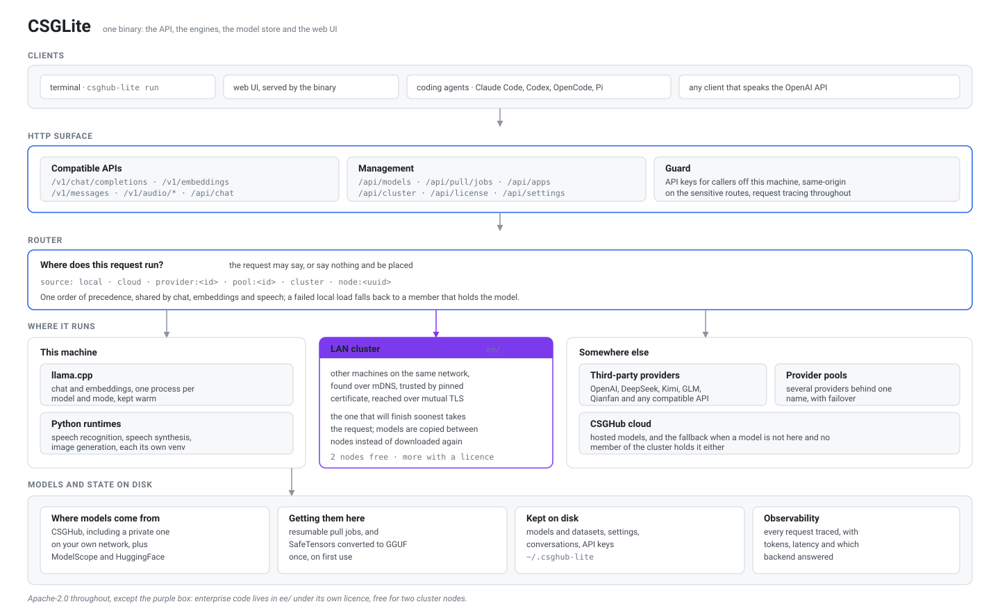

[](https://signals.gitdealflow.com/startup/opencsgs)
# CSGLite
<p align="center">
  
</p>

A lightweight tool for running large language models locally, powered by models from the [CSGHub](https://opencsg.com) platform.

Inspired by [Ollama](https://ollama.com), CSGLite provides model download, local inference, interactive chat, and an OpenAI-compatible REST API — all from a single binary.

A request arrives at one of the compatible APIs, the router decides where it
runs, and the answer comes back in the same shape whether it was served here,
by another machine on your network, or by a provider.

## Features

### Core

- **One command to start** — `csghub-lite run` downloads, loads, and chats
- **Model keep-alive** — models stay loaded after exit (default 5 min, or set per model in the Web UI run dialog), instant reconnect
- **Auto-start server** — background API server starts automatically, no manual setup
- **Model download** from CSGHub platform (hub.opencsg.com or private deployments)
- **Local inference** via llama.cpp (GGUF models, SafeTensors auto-converted)
- **Interactive chat** with streaming output
- **REST API** compatible with Ollama's API format
- **OpenAI-compatible API** — Chat Completions (including `logprobs`, `top_logprobs`, `logit_bias`, and `response_format`), Responses, Embeddings, Images, Audio, Realtime, and the Decisions API (`POST /v1/decisions`); the official OpenAI SDKs work with `base_url` pointed at CSGLite
- **Cross-platform** — macOS, Linux, Windows
- **Resume downloads** — interrupted downloads resume where they left off
- **Pause/Resume** — pause ongoing downloads and resume later
- **LAN cluster** — install the same binary on several machines with one shared
  secret and they form a pool of compute: requests land on whichever node will
  finish soonest, models are copied between nodes instead of downloaded again,
  and an address that changes on reboot is relearned. Two nodes without a
  licence, unlimited with one.

### Web UI

- **Model Library** — manage local models with download progress, pause/resume, and one-click run
- **Marketplace** — browse and download models/datasets from CSGHub
- **Chat Interface** — interactive chat with local and cloud models
- **AI Apps** — install and launch AI applications with one-click configuration
- **Settings** — configure storage, third-party providers, and access tokens

### Integrations

- **Third-Party Providers** — integrate OpenAI, DeepSeek, MiMo, Kimi, BigModel, Qianfan, MiniMax, OpenRouter, and any OpenAI-compatible API
- **Coding Agents** — one-click config for Claude Code, Codex, Pi, OpenCode, and Open Code Review
- **Context compression** — optionally shrinks the tool output inside agent requests before any model sees it (Settings → Context compression). Safe mode removes only redundancy and keeps every distinct line; aggressive mode also samples long logs, arrays and search results. File reads and source code are never changed. On captured Claude Code / Codex traffic tool output drops 6% (safe) to 17% (aggressive), search results 24–56%; savings per request show in Observability
- **AI Applications** — one-click setup for Claude Code, OpenCode, Open Code Review, Codex, Codex App, ZCode, Pi, OpenClaw, CSGClaw, CSGStudio, Dify, and AnythingLLM

### Dataset Support

- **Dataset download** from CSGHub platform
- **Dataset management** — list, show details, and delete local datasets

## Installation & Upgrade

### Desktop client

Download the desktop client from the [CSGLite product page](https://opencsg.com/products/csglite).

### CLI client

#### Linux / macOS

```bash
curl -fsSL https://hub.opencsg.com/csghub-lite/install.sh | sh
```

Pin a release version:

```bash
curl -fsSL https://hub.opencsg.com/csghub-lite/install.sh | CSGHUB_LITE_VERSION=v0.8.55 sh
```

#### Windows PowerShell

```powershell
irm https://hub.opencsg.com/csghub-lite/install.ps1 | iex
```

### From source

```bash
git clone https://github.com/opencsgs/csglite.git
cd csglite
make build
# Binary is at bin/csghub-lite
```

### From GitHub Releases

Download the latest binary for your platform from the [Releases](https://github.com/opencsgs/csglite/releases) page.

### Docker

For Docker installation, see the [Docker guide](https://github.com/OpenCSGs/csglite/blob/main/docs/guides/docker.md).

## Quick Start

```bash
# Run a model — downloads, starts server, and chats (all automatic)
csghub-lite run Qwen/Qwen3-0.6B-GGUF

# Keep a model loaded until you stop it manually
csghub-lite run Qwen/Qwen3-0.6B-GGUF --keep-alive -1

# Search for models on CSGHub
csghub-lite search "qwen"

# Check running models (model stays loaded after exit)
csghub-lite ps

# Set CSGHub access token (optional, for private models)
csghub-lite login
```

> **Note:** The install script automatically installs [llama-server](https://github.com/ggml-org/llama.cpp) (required for inference). If you installed from source, install it separately: `brew install llama.cpp` (macOS) or download from [llama.cpp releases](https://github.com/ggml-org/llama.cpp/releases).

## LAN cluster

Machines on the same network can share one pool of compute. Give every machine
the same secret and they find each other; there is no separate create or join
step:

```bash
csghub-lite config set cluster_secret "a-long-shared-secret"
csghub-lite config set cluster_name "lab"
csghub-lite restart
```

The same values can be set at install time with `CSGHUB_LITE_CLUSTER_SECRET`
and `CSGHUB_LITE_CLUSTER_NAME`. The first machine to start creates the cluster;
later ones join when they see it. A request this machine cannot serve is
forwarded to a member that can, models are copied over the LAN instead of
downloaded again, and an address that changes on reboot is picked up
automatically. Two nodes work without a licence; more need a CSGLite Enterprise
licence. A machine with no secret stays a single node and opens no cluster
port.

Routing, model sync, join tokens, and admission codes are in the
[cluster command reference](docs/cli/cluster.md).

## Local Inference Capabilities

CSGLite can run several model families locally today, with more runtime
types planned. The model detail page shows whether a downloaded model is
currently supported for local inference.

| Capability | Status | Runtime | Typical models |
| --- | --- | --- | --- |
| Text generation / chat | Supported | llama.cpp | Qwen/Qwen3, GLM, Llama, Mistral, DeepSeek distilled GGUF models |
| Embeddings | Supported | llama.cpp | BGE, GTE, E5, Sentence Transformers-compatible embedding models |
| Vision-language chat | Supported | llama.cpp multimodal | Qwen2.5-VL, Gemma 3 / 4 vision, Idefics-style multimodal models |
| Text-to-image | Supported | Diffusers runtime; MLX on Apple Silicon | Qwen-Image, Qwen-Image-2.1 MLX (including Turbo), FLUX, Stable Diffusion, PixArt, Sana, CogView, Z-Image, Kolors, Hunyuan |
| Image-to-image | Supported | Diffusers runtime; MLX on Apple Silicon for one reference image | Qwen-Image-Edit, FLUX Kontext, inpaint, img2img, editing pipelines |
| Automatic speech recognition | Supported | Python ASR runtime | FunASR, Whisper, Wav2Vec2-family ASR models |
| Text-to-speech | Supported | Python TTS runtime | VoxCPM, Qwen3-TTS, Kokoro, MMS-TTS and other transformers-native TTS models |
| Realtime voice | Supported | Python ASR + TTS runtimes | Full-duplex over WebRTC or WebSocket, OpenAI Realtime-compatible |
| Decisions | Supported | llama.cpp (decision LoRA or native head) | JEV models such as `autotrust/JEV-9B` and its GGUF quantizations; native decision models such as `convaiinnovations/laya`; OpenAI Decisions API-compatible |
| Image-to-video | Coming soon | - | Stable Video Diffusion, SV3D |
| Text-to-video | Coming soon | - | Video generation Diffusers models |

### Image models

Image requests use `POST /v1/images/generations` and `POST /v1/images/edits`.
NVIDIA, AMD, and CPU machines run Diffusers checkpoints. Apple Silicon uses
MFLUX for MLX Qwen-Image-2.1 checkpoints and Diffusers for the other image
families. Other MLX image checkpoints are unsupported on every platform,
including before download. The model library disables **Run** for any
downloaded model that cannot run locally.

| Model | Runtime | Notes |
| --- | --- | --- |
| `Qwen/Qwen-Image`, `Qwen/Qwen-Image-2512` | Diffusers | Text-to-image |
| `Qwen/Qwen-Image-Edit`, `Qwen/Qwen-Image-Edit-2511` | Diffusers | Image editing, including multi-image edits |
| `mlx-community/Qwen-Image-2.1-MLX-4bit` | MFLUX on Apple Silicon | Text-to-image and one reference image, 40 steps by default. Runs on a 16 GB Mac: about 4 minutes for 1024x1024. Python 3.10 or newer. `n=1` only |
| `OsaurusAI/Qwen-Image-2.1-Turbo-mflux-4bit` and other mflux-saved Qwen-Image-2.1 bundles | MFLUX on Apple Silicon | Turbo is the 8-step distilled checkpoint, sampled on the fixed sigma grid in its `model_index.json`; the `steps` request field is ignored. About 70 seconds for 1024x1024 on a 16 GB Mac. Weights are under the Qwen Research License (non-commercial) |
| FLUX, Stable Diffusion, Stable Cascade, PixArt, Sana, CogView, Z-Image, Kolors, Hunyuan, Kandinsky, Lumina, AuraFlow, GLM-Image, Ovis-Image | Diffusers | Text-to-image when `model_index.json` names that pipeline |
| FLUX Kontext, Stable Diffusion img2img and inpaint | Diffusers | Image-to-image and editing |
| GGUF image models such as `unsloth/Qwen-Image-2.1-Turbo-GGUF` | Not supported | A GGUF image file holds only the denoiser and needs a separate VAE and text encoder. Download a Diffusers or MLX version of the model instead |

### Text-to-speech models

Speech synthesis runs in its own Python runtime, never through llama.cpp: the
vocoder or codec decoder that turns model output into a waveform only exists in
the model's own inference stack. Synthesize with `POST /v1/audio/speech`, or
select a text-to-speech model in Chat and send text to hear it.

| Model | Size | Voices | Notes |
| --- | --- | --- | --- |
| `openbmb/VoxCPM2` | 4.6 GB | Reference-audio cloning | Streams natively; the audio VAE ships with the model |
| `Qwen/Qwen3-TTS-12Hz-0.6B-CustomVoice` | 2.3 GB | 9 presets, 5 Chinese incl. Beijing and Sichuan | Codec ships with the model |
| `hexgrad/Kokoro-82M` | 327 MB | 54 presets, 8 Chinese | Smallest option |
| `facebook/mms-tts-eng` | 145 MB | Single speaker | Same code path serves the MMS family across many languages |

`GET /api/tts-voices?model=<id>` lists what a given model can render, since
voices differ per model rather than being a fixed set. The transformers-native
path also covers SpeechT5, Bark, ParlerTTS, CSM, Dia and FastSpeech2 models.

### Realtime voice

Full-duplex speech, compatible with the OpenAI Realtime API and served by the
same recognition and synthesis runtimes:

| Transport | Endpoint | Audio |
| --- | --- | --- |
| WebRTC | `POST /v1/realtime/calls` (SDP offer in, SDP answer out) | Media tracks: Opus in, PCMU out; events on the `oai-events` DataChannel |
| WebSocket | `GET /v1/realtime` | Base64 PCM16 in `input_audio_buffer.append` and `response.output_audio.delta` |

`GET /v1/realtime/transcription` opens a recognition-only session. Recognition
streams partial transcripts as you speak, synthesis starts playing before the
sentence is finished, and `response.cancel` stops playback for barge-in. Set
defaults and limits in the `realtime` section of `config.json`
(`default_asr_model`, `default_tts_model`, `max_sessions`, and the ICE options
for a deployment that has to pin its media ports). The protocol and the
measured latencies are in
[docs/guides/realtime-audio-api.md](docs/guides/realtime-audio-api.md).

### Decisions

CSGLite implements the [OpenAI Decisions API](https://developers.openai.com/api/docs/guides/decisions),
`POST /v1/decisions`, for local decision models: JEV models tagged `jev` or
`typed-decisions` (for example `autotrust/JEV-9B` and its GGUF quantizations)
and native decision models whose head llama.cpp runs directly (for example
`convaiinnovations/laya` and `laya-typed-decisions`). A request shares one
`input` across up to 200 questions and returns calibrated probabilities instead
of generated text:

| Question type | Use it to | Main result |
| --- | --- | --- |
| `predicate` | check whether a condition is true | `probability` |
| `choice` | pick one of 2-255 string or boolean values | `choice`, `probabilities`, `confidence` |
| `score` | rate against ordered `levels` | `score` (probability-weighted level index), `probabilities`, `confidence` |

| Model | Size | Chat | Notes |
| --- | --- | --- | --- |
| `autotrust/JEV-9B` | 17 GB (BF16) | Yes | Qwen3.5-9B with a System 1 decision adapter; converted to GGUF on first use, `q8_0` fits a 16 GB Mac |
| `mradermacher/JEV-9B-GGUF` | 5.2 GB (Q4_K_M) | Yes | Base weights only: also pull `autotrust/JEV-9B` for the decision adapter |
| `convaiinnovations/laya` | 842 MB | No | ModernBERT-large encoder with a decision head; English, trained on 512-token inputs |
| `convaiinnovations/laya-typed-decisions` | 842 MB | No | Laya fine-tuned on the typed-decisions workflows (agent traces, customer service, invoices, security incidents); 1,024-token inputs |

Other GGUF models that llama.cpp runs as native decision models (Julia,
OpenJev, Lev, Kev, Nimble, Clef, Perplexity Decider, LFM2-D1) are recognized
from their GGUF metadata and served the same way.

```bash
curl http://localhost:11435/v1/decisions -H "Content-Type: application/json" -d '{
  "model": "huggingface/mradermacher/JEV-9B-GGUF",
  "input": "I was charged twice for my order.",
  "questions": [{
    "type": "choice",
    "name": "department",
    "instructions": "Which department should handle this complaint?",
    "choices": [{"value": "billing"}, {"value": "technical"}, {"value": "shipping"}, {"value": "other"}]
  }]
}'
```

The OpenAI SDKs' `client.decisions.create(...)` works unchanged with
`base_url="http://localhost:11435/v1"`. GGUF quantizations ship only the base
weights, so also pull the original repository (`autotrust/JEV-9B`) that holds
the decision adapter; CSGLite converts and loads it automatically, and the same
model keeps answering ordinary chat. Laya is a ModernBERT encoder with a
decision head: CSGLite converts it to GGUF on first use, it answers decisions
only, and Chat opens it straight in **Decide** mode. For other models, pick the
model in Chat and switch the composer to **Decide**. Text input only: `input_image` parts are
refused. `POST /v1/decide` remains available for clients written against the
JEV API. Details: [docs/guides/typed-decisions.md](docs/guides/typed-decisions.md).

## Integrations

### Third-Party Model Providers

CSGLite supports integrating third-party OpenAI-compatible API providers. Configure providers in Settings, and their models appear alongside local and OpenCSG models in Chat.

Supported providers include:

| Provider | Notes | Base URL |
| --- | --- | --- |
| OpenAI | OpenAI-compatible | `https://api.openai.com/v1` |
| DeepSeek | - | `https://api.deepseek.com/v1` |
| MiMo | Xiaomi | `https://api.xiaomimimo.com/v1` |
| Kimi | Moonshot | `https://api.moonshot.cn/v1` |
| BigModel | Zhipu/智谱AI | `https://open.bigmodel.cn/api/paas/v4` |
| Qianfan | Baidu | `https://qianfan.baidubce.com/v2` |
| MiniMax | - | `https://api.minimaxi.com/v1` |
| OpenRouter | - | `https://openrouter.ai/api/v1` |
| Any OpenAI-compatible API | Custom provider | Custom base URL |

### Coding Agents

One-click configuration for popular coding agents. Models from local, OpenCSG, or third-party providers work seamlessly:

| Agent | Config Location | One-Click Setup |
|---|---|---|
| **Claude Code** | `~/.claude/settings.json` | `csghub-lite launch claude-code --model <model>` |
| **Codex** | `~/.codex/config.toml` | `csghub-lite launch codex --model <model>` |
| **ZCode** | `~/.zcode/v2/config.json` | Web UI → AI Apps → select model → Launch |
| **Pi** | `~/.pi/agent/settings.json` | `csghub-lite launch pi --model <model>` |
| **Kimi Code** | `~/.kimi-code/config.toml` | `csghub-lite launch kimi-code --model <model>` |
| **DeepSeek Harness** | `~/.dsh/settings.yaml` | `csghub-lite launch dsh --model <model>` |
| **OpenCode** | `~/.opencode.json` | `csghub-lite launch open-code --model <model>` |

After the first launch via CSGLite, subsequent runs use the configured settings automatically — no manual API key or base URL setup needed.

Example:
```bash
# Configure Claude Code with GLM model
csghub-lite launch claude-code --model "glm-4-flash"

# Configure Codex with local Qwen model
csghub-lite launch codex --model "Qwen/Qwen2.5-Coder-7B"

# Configure Pi with Kimi model
csghub-lite launch pi --model "moonshot-v1-8k"

# Configure Kimi Code with GLM model
csghub-lite launch kimi-code --model "glm-4-flash"

# Configure DeepSeek Harness with GLM model
csghub-lite launch dsh --model "glm-4-flash"
```

### AI Applications

One-click setup for AI assistant applications:

| App | Description | Setup |
|---|---|---|
| **Claude Code** | Anthropic agentic coding tool | `csghub-lite launch claude-code` or Web UI → AI Apps |
| **OpenCode** | Open-source AI coding agent | `csghub-lite launch open-code` or Web UI → AI Apps |
| **Open Code Review** | AI code review CLI | `csghub-lite launch ocr` or Web UI → AI Apps |
| **Codex** | OpenAI coding agent CLI | `csghub-lite launch codex` or Web UI → AI Apps |
| **Codex App** | OpenAI desktop coding app | Web UI → AI Apps |
| **ZCode** | Z.ai cross-platform desktop coding app | Web UI → AI Apps |
| **Pi** | Lightweight terminal coding agent | `csghub-lite launch pi` or Web UI → AI Apps |
| **Kimi Code** | Terminal AI coding agent | `csghub-lite launch kimi-code` or Web UI → AI Apps |
| **DeepSeek Harness** | Plugin-based agent harness | `csghub-lite launch dsh` or Web UI → AI Apps |
| **OpenClaw** | Open-source AI assistant with web UI | `csghub-lite launch openclaw` or Web UI → AI Apps |
| **CSGClaw** | macOS/Windows multi-agent desktop application | Web UI → AI Apps |
| **CSGStudio** | OpenCSG desktop studio; enabled on platforms its release channel publishes | Web UI → AI Apps |
| **Dify** | LLM app development platform | Web UI → AI Apps |
| **AnythingLLM** | Private document chat | Web UI → AI Apps |

Managed apps auto-configure to use CSGLite's OpenAI-compatible API endpoint with your selected models.

## CLI Commands

| Command | Description |
|---|---|
| `csghub-lite run <model>` | Pull, start server, and chat (all automatic) |
| `csghub-lite chat <model>` | Chat with a locally downloaded model |
| `csghub-lite ps` | List currently running models and their keep-alive |
| `csghub-lite start` | Start the API server in the background |
| `csghub-lite stop` | Stop the background API server |
| `csghub-lite stop model [MODEL]` | Stop/unload a running model |
| `csghub-lite serve` | Start the API server in the foreground (auto-started by `run`) |
| `csghub-lite restart` | Restart the background API server |
| `csghub-lite pull <model>` | Download a model from CSGHub |
| `csghub-lite list` / `ls` | List locally downloaded models |
| `csghub-lite show <model>` | Show model details (format, size, files) |
| `csghub-lite rm <model>` | Remove a locally downloaded model |
| `csghub-lite login` | Set CSGHub access token |
| `csghub-lite search <query>` | Search models on CSGHub |
| `csghub-lite config set <key> <value>` | Set configuration |
| `csghub-lite config get <key>` | Get a configuration value |
| `csghub-lite config show` | Show current configuration |
| `csghub-lite uninstall` | Remove CSGLite and llama-server, preserving local data unless `--all` is set |
| `csghub-lite --version` | Show version information |

Model names use the format `namespace/name`, e.g. `Qwen/Qwen3-0.6B-GGUF`.

### run vs chat

- **`run`** — Downloads the model if not present, auto-starts the background server, and opens a chat session. After you exit, the model stays loaded for 5 minutes by default so the next `run` is instant. Use `--keep-alive -1` to keep it loaded until you stop it manually.
- **`chat`** — Starts a chat session with a model that is already downloaded. Supports `--system` flag for custom system prompts.

```bash
# Auto-download and chat (first time)
csghub-lite run Qwen/Qwen3-0.6B-GGUF

# Exit chat, model stays loaded — reconnect instantly
csghub-lite run Qwen/Qwen3-0.6B-GGUF

# Keep the model loaded until `csghub-lite stop model`
csghub-lite run Qwen/Qwen3-0.6B-GGUF --keep-alive -1

# Check which models are still loaded
csghub-lite ps

# Chat with custom system prompt (model must be downloaded)
csghub-lite chat Qwen/Qwen3-0.6B-GGUF --system "You are a coding assistant."
```

### Interactive Chat Commands

Once in a chat session (`run` or `chat`):

| Command | Description |
|---|---|
| `/bye`, `/exit`, `/quit` | Exit the chat |
| `/clear` | Clear conversation context |
| `/help` | Show help |

End a line with `\` for multiline input. Press Ctrl+D to exit.

## Supported Platforms

### Operating Systems & Architectures

| Platform | Support |
|---|---|
| Ubuntu (x86_64, ARM64) | Supported |
| Debian (x86_64, ARM64) | Supported |
| CentOS (x86_64, ARM64) | Supported |
| macOS (x86_64, Apple Silicon) | Supported |
| Windows (x86_64) | Supported |

### Accelerators and Compute Boxes

| Hardware | Support |
|---|---|
| Mac mini | Supported |
| AMD Instinct MI50 | Supported |
| AMD Instinct MI200 / MI250 | Supported |
| NVIDIA GPU series | Supported |

## REST API

The server listens on `localhost:11435` by default.

OpenAI-compatible endpoints (point any OpenAI SDK at `http://localhost:11435/v1`):

| Endpoint | Purpose |
| --- | --- |
| `POST /v1/chat/completions` | Chat completions, streaming, tools, `logprobs` / `top_logprobs`, `logit_bias`, `response_format` |
| `POST /v1/responses` | Responses API |
| `POST /v1/messages` | Anthropic Messages API |
| `POST /v1/embeddings` | Embeddings |
| `POST /v1/images/generations`, `POST /v1/images/edits` | Image generation and editing |
| `POST /v1/audio/transcriptions`, `POST /v1/audio/speech` | Speech recognition and synthesis |
| `POST /v1/realtime/calls`, `GET /v1/realtime` | Realtime voice over WebRTC or WebSocket |
| `POST /v1/decisions` | Decisions API: predicate, choice, and score questions |
| `GET /v1/models` | List models |

For full endpoint details and examples, see the [REST API Reference](docs/api/overview.md).

If the local server is running, you can also open the interactive API docs in your browser:
[http://localhost:11435/api-docs.html](http://localhost:11435/api-docs.html)

## Logs

By default, CSGLite writes logs under `~/.csghub-lite/logs/`:

- `csghub-lite.log` — API server logs
- `llama-server.log` — llama-server subprocess logs

## Configuration

Configuration is stored at `~/.csghub-lite/config.json`.

The CLI and Web UI expose a convenience `storage_dir` setting. When you set it, CSGLite expands it into the persisted `model_dir` and `dataset_dir`.

| Key | Default | Description |
|---|---|---|
| `storage_dir` | `~/.csghub-lite` | Shared local storage root for models and datasets |
| `server_url` | `https://hub.opencsg.com` | CSGHub platform URL |
| `ai_gateway_url` | `https://ai.space.opencsg.com` | AI Gateway URL for cloud inference models |
| `model_dir` | `~/.csghub-lite/models` | Effective local model storage directory |
| `dataset_dir` | `~/.csghub-lite/datasets` | Effective local dataset storage directory |
| `listen_addr` | `:11435` | API server listen address |
| `token` | (none) | CSGHub access token |

### Environment variables

See the [Environment Variables Reference](docs/guides/environment-variables.md)
for all CSGLite runtime, llama.cpp/ROCm, installer, Python runtime, and AI Apps
environment variables, including defaults and supported values.

Switch to a private CSGHub deployment:

```bash
csghub-lite config set server_url https://my-private-csghub.example.com
```

## Development

```bash
# Run tests
make test

# Run tests with coverage
make test-cover

# Build for all platforms
make build-all

# Test goreleaser locally (no publish)
make release-snapshot

# Lint
make lint
```

## Documentation

Full documentation is available in the [`docs/`](docs/) directory:

- **Getting Started**: [Installation](docs/getting-started/installation.md) | [Quick Start](docs/getting-started/quickstart.md)
- **CLI Reference**: [All Commands](docs/cli/overview.md)
- **REST API**: [API Reference](docs/api/overview.md)
- **Guides**: [Configuration](docs/guides/configuration.md) | [Environment Variables](docs/guides/environment-variables.md) | [LAN Cluster](docs/cli/cluster.md) | [Model Formats](docs/guides/model-formats.md) | [Packaging](docs/guides/packaging.md) | [Architecture](docs/guides/architecture.md)

## License

Apache-2.0, with one exception: everything under the `ee/` directory is
licensed under the [CSGLite Enterprise Edition License](ee/LICENSE). EE code
may be used freely for development and testing; production use requires a
valid CSGLite Enterprise license issued by OpenCSG, except within the community
limits the software enforces without one. See
[`docs/guides/ee-license-design.md`](docs/guides/ee-license-design.md).
