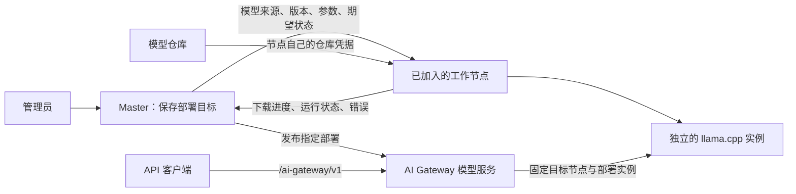

# 集群模型管理与托管部署

Lite 将模型文件、运行实例和对外模型服务分开管理。公网 Master/Slave 集群中，
**加入集群即接受 Master 的模型下载、部署和启停控制**，无需二次授权。
公网使用已有的出站 TLS 隧道，局域网使用成员证书与 mTLS，无需另开工作节点管理端口。

## 管理关系

- 公网 Slave 的控制节点直接取自已加入集群的 `gateway_uuid`，不能在设置中另选 Master 或切换为“仅共享”。
  既有成员升级后也自动适用；Master 无需等待节点再次授权。退出集群解除管理关系。
- 正常、排空、维护只改变节点是否执行工作，不改变 Master 身份。维护期间仍可接收和记录 Master 的期望状态；
  恢复正常后按最新状态执行。
- Master 下发的部署自动上报。额外共享的本地模型仅用于发布节点已有模型，留空不影响托管部署。
- 原有 LAN 模式是对等集群，没有固定 Master；仍由节点在设置中选择一个控制节点，默认只共享。

箭头表示逻辑流向。公网控制和推理都复用 worker 主动连接 Master 的隧道。

## 使用流程

1. 两端更新 Lite，加入同一集群，工作节点安装可用的推理引擎。
2. 公网工作节点加入 Master 后即接受其管理，在“集群 → 设置”可查看所属 Master 和工作状态。LAN 对等节点仍需选择控制节点。节点须处于正常工作状态。
3. 在主节点“集群 → 模型管理”选择“创建部署”。搜索或输入模型仓库后，自动读取详情识别类型、匹配推理引擎；
   只有无法识别时才显示类型选择。新部署使用仓库默认分支的最新版本，页面无需选择分支或 commit。
   部署名称自动生成；量化选择直接显示，上下文、并行槽位、GPU 层数及自定义名称收在“高级设置”。
   来源支持 OpenCSG、Hugging Face、ModelScope，ModelScope 缺省分支为 `master`，其他来源回退为 `main`。
   目标节点默认 Auto，仅从在线、可接单、正常、配额有效且受当前控制端管理的节点中选择，优先 GPU 节点及更多可用显存，同等容量时选择负载更低的节点。
   也可手动选择节点；列表显示显存总量和可用容量，统一内存只计一次，CPU 节点显示系统内存。未报告的 GPU 占用不会当作零占用。
   创建时确定并保存实际节点 UUID，停止、重启或重试不会重新选择节点。
   量化默认按实际 GGUF 文件大小（含分片）推荐；可转换模型缺少文件大小时按参数量估算，只推荐仓库已有或运行引擎可转换的类型。
   在预留上下文、并发和运行开销后，优先选择可容纳的较高精度版本。切换节点和运行参数会刷新推荐，手动量化不会被覆盖。
   无法估算时显示原因并沿用模型默认精度；已知版本均不适合时，可换节点、降低上下文/并发或手动选择量化使用 CPU 卸载。
   这是部署前估算，实际 KV cache、计算缓冲区和 GPU 分配由模型架构及运行引擎确定，不保证一定启动成功。
   文生图、ASR、TTS 当前会显示未支持托管部署并禁止提交；不会作为 llama.cpp 对话模型启动。
   搜索和识别使用控制端仓库连接，实际下载使用目标节点仓库连接。
4. 查看排队、下载、加载和就绪状态。下载、加载失败、运行实例退出或推理发生致命计算错误时显示失败及原因，由管理员重试。
5. 就绪后选择“发布模型服务”，设置唯一的对外模型 ID。之后在 AI Gateway 管理服务、
   API Key 并使用每个模型行内的推理测试。对外入口统一为 `/ai-gateway/v1`。
6. 停止部署后拒绝新的推理，等待已有请求结束再释放运行实例；文件保留用于再次启动。
   模型服务配置独立保留，可在 AI Gateway 关闭或删除服务。

相同仓库可以创建多个部署，每个部署都有独立内部 ID。发布时明确绑定
`node:<uuid>` 和 `deployment/<id>`，不会因仓库名称相同而自动合并或切换到其他模型。
仓库、版本、量化和运行参数创建后不可修改；改变这些参数需创建另一个部署。
创建页面使用默认分支最新版本，停止/重启保留当前缓存，不会自动升级已有实例。
需要固定版本的自动化客户端仍可在 API 传入仓库提交 ID；使用 `main` 等分支只保证重用当前部署的已有缓存，
不能保证首次下载前分支内容不变。

## 统一模型管理页面

控制端将原「模型分布」与「模型部署」合并为「模型管理」，只展示一张实例列表。页面顶部创建部署，
每行统一展示模型 ID、运行机器与角色、运行状态及下载进度、发布状态、速度和大小。
托管部署与节点上已有模型用标签区分；部署名称、版本、来源及精确运行实例 ID 收在行内详情中。

- 同一节点、同一运行实例的心跳与部署回执合并为一行。相同仓库的独立部署或不同节点副本继续分行。
- 排队、下载、加载、运行、停止、失败和离线均保留；即使目标节点已移出成员列表，未删除的部署记录仍可查看。
- 支持按模型 ID、部署名称或运行机器搜索，并按机器、状态筛选。只使用一组模型/部署刷新请求，失败时保留上次数据并提示。
- 从对应行发布模型服务，绑定准确的 `node:<uuid>` 与运行模型 ID。已有模型文件可发布后按需加载；托管部署须就绪才能发布。
  行内仅保留「发布」和「更多」。发布状态根据精确实例的网关绑定显示未发布、已发布或未启用；已绑定实例通过「更多 → 网关服务」管理。
  模型正在下载、停止、删除、维护、不可连接或发布状态未知时，发布按钮禁用。发布对话框在提交前再次检查当前状态。
- 启动/重试、卸载、删除及 LAN 同步收进「更多」，根据模型生命周期、节点在线与维护状态、控制权限和刷新结果禁用不适用的操作。
  继续复用原有生命周期接口与确认框，操作权限不因页面合并改变。
  未拿到部署回执的托管运行实例只读，避免误用普通模型的删除接口。
- Slave 集群页仅展示本机运行模型，不新增控制端入口。LAN 的模型同步与调度诊断入口保留。

## 状态、恢复与边界

- Master 保存期望状态，worker 保存执行回执。每次启停或重试递增 generation；
  重复下发不会重复启动，旧 generation 不会恢复已经停止的实例。
- Worker 重启后重新加载原来应运行的实例；已失败实例仍需显式重试。
- 就绪状态会持续检查底层运行健康。GPU 内存不足或计算后端已失效时，即使进程和 HTTP 健康接口仍存活，也会转为失败、上报原因并退出可用模型目录。失败实例保留模型文件，不循环自动重载；管理员修正运行配置后显式重试。用户参数错误、限流和取消请求不会被当作部署失败。
- 断网时 Master 显示无法连接，不声称远端已经停止。停止请求在恢复连接后送达；
  本机可切换维护状态暂停执行，或退出集群解除控制。
- 退出集群、停止接单、排空/维护或失去节点配额时，节点拒绝新的托管推理并停止实例。
  恢复正常工作且仍属于原 Master 时，继续执行其期望运行的任务；要永久停止某任务，应在 Master 将其停止。
  LAN 对等节点还可撤销显式控制节点授权。退出集群不删除 Master 上的部署记录。
- 当前每个 worker 同时只准备一个新实例，避免并发下载和加载争用资源。已有就绪实例可并行服务。
  下载检查磁盘预留；显存和引擎是否支持该模型仍以实际加载结果为准。
- 下载可取消；底层同步加载器须返回后才能关闭被取消的运行实例。停止过程中显示“正在停止”。
- 支持 llama.cpp 对话和 embedding 部署及创建时自动选择节点；不包含多副本扩缩容、迁移、
  跨节点切分、其他推理引擎安装或容器调度。模型仓库凭据使用工作节点现有配置，Master 不转发凭据。
- 每端最多 64 条未完成删除的部署/回执；支持启停、重试和删除。成功删除保留防重放记录，不占活动部署额度。
  同来源、同仓库的部署复用模型库缓存；同一模型只保存一份文件。

类型化决策模型通过 `/ai-gateway/v1/decisions` 调用；请求成功与失败都会写入调用端的观测历史，
协议显示为 `decisions`，保留对外模型 ID、实际节点路由、部署模型 ID、输入 Token 及请求/响应内容。
决策接口不生成文本，因此不会把完整决策耗时当作首字延迟。工作节点也记录其收到的本机决策调用；
网关返回的观测请求 ID 对应网关自己的记录。历史未采集的决策请求无法追溯补写。

## 配置和存储

OpenCSG 部署使用仓库实际默认分支（通常为 `main`），不支持自定义分支、标签或提交。
部署请求中的默认分支名称会与仓库元数据核对后，使用 OpenCSG 的默认分支接口下载；
Hugging Face 和 ModelScope 仍支持显式指定版本。已有失败部署可在执行节点更新后重试。

公网控制关系复用 `cluster/cluster.json` 中的 `cluster.gateway_uuid`，不增加第二份可写授权。
API 和心跳中的 `managed_by` 返回派生的 Master UUID；旧版公网 `settings.managed_by` 在加载时迁移移除。
旧客户端提交空值或当前 Master 不改变控制关系，提交其他 UUID 返回 400。
LAN 对等集群继续使用 `settings.managed_by`，缺省为空时只共享。
新部署运行状态保存在存储根目录下 `cluster/deployments.json`，
其中 `owned` 是本机控制的部署目标，`assignments` 是本机执行的持久回执。
现有集群设置不适合表达带版本号和生命周期的任务，因此采用单独的集群任务文件；
不增加重叠的模型服务配置。

模型文件统一使用节点配置的 `model_dir`（默认 `<storage-root>/models`），沿用普通模型下载的来源目录布局。部署仅单独记录运行参数和生命周期，不创建模型目录副本。启动时会把旧 `cluster/deployment-models/<deployment-id>/` 中的完整模型、转换文件和断点续传状态迁入模型库；相同快照合并，文件或版本冲突时保留旧数据并报错，不覆盖现有模型。
对外服务沿用现有 `provider_pools.json`，推理调用的 `keep_alive` 不改变托管实例生命周期。

## 管理 API

| 方法 | 路径 | 用途 |
| --- | --- | --- |
| PUT | `/api/cluster/settings` | 节点工作状态、资源限制；仅 LAN 可设置 `managed_by` |
| GET | `/api/cluster/deployments` | 本机控制的部署和本机接收的执行任务 |
| POST | `/api/cluster/deployments` | 创建指定节点或 Auto 部署，返回 202 |
| PUT | `/api/cluster/deployments/{id}` | 设置 `desired: running/stopped`，返回 202 |
| POST | `/api/provider-pools` | 将就绪部署发布为既有模型服务 |

管理 API 沿用现有访问策略和公网管理登录。隧道新增的私有部署指令是固定路径、固定方法、
限大小的结构化请求，不接受 shell、任意文件路径或任意管理 URL；普通推理通道不能调用它。
公开 API 详见 [OpenAPI](../../openapi/local-api.json)。

创建请求的 `node_uuid` 可传节点 UUID、`"auto"`、空字符串或省略。后面三种形式均在创建时自动选择节点，响应和持久记录始终返回实际节点 UUID。
网页上的 Auto 量化在提交时解析为推荐的明确 `quant` 值；API 省略 `quant` 仍保持原有默认精度语义。
网页同时传入仅用于创建请求的 `minimum_memory_bytes`，控制端按最新状态重新筛选节点；没有足够的已报告容量时拒绝创建并提示刷新。
此估算不写入部署或配置文件，不代表资源预留，创建后仍以运行引擎的实际分配结果为准。手动量化不传该限制，保留 CPU 卸载的选择。

## 设计参考

参考 [GPUStack 架构](https://docs.gpustack.ai/2.0/architecture/)及其
[部署管理](https://docs.gpustack.ai/2.0/user-guide/model-deployment-management/)的控制端与执行端职责划分，
以及 [Xinference 分布式启动](https://inference.readthedocs.io/en/stable/user_guide/launch.html)
中的 Supervisor/Worker 分工。Lite 公网集群采用加入即接受 Master 管理的方式，LAN 对等集群保留显式控制节点选择，
并复用自身的出站隧道、llama.cpp 和 AI Gateway；未引入这些项目的调度器或运行时。

## Slave 操作边界

公网 Slave 只执行已加入集群的 Master 的部署指令，不显示“模型部署”“模型分布”或全局节点表。
集群页页头集中显示节点名称、Master 连接状态和“节点设置”入口，主体仅保留“本机正在运行的模型”，
每 3 秒从 `/api/ps` 更新；不再展示资源统计、页签和独立任务列表。模型列表只读，包含本机启动与 Master 托管实例，
不混入其他节点的模型。获取失败时明确提示，并保留上次成功结果；长错误显示三行，点击“更多”查看完整内容。
断连、暂停和配额异常仍单独提示，节点设置提供返回模型列表入口。所属 Master 由成员关系确定，只读展示。
下载任务进度和错误仍可在本机模型库查看，集群模型和部署操作由 Master 管理。
退出后显示“连接集群”，网络状态与加入表单合并为同宽卡片；可直接使用 Master 令牌加入，加入时自动开启集群网络。

- 禁止创建部署、启停部署、创建集群、邀请节点、移除成员、生成接入码、轮换加入令牌，
  以及通过集群接口向本机或其他节点下发下载/同步请求；API 同样返回 403，不能绕过 UI。
- 不展示全局调度策略、会话亲和队列设置和调度分析；这些由 Master 管理。
- 保留本机名称、正常/排空/维护状态、磁盘预留、调度权重、额外共享的本地模型、日志及退出集群。
  Slave 设置页不再同时提供接单开关和状态选择；旧 `accept_work=false` 在页面表现为维护，选择正常后恢复接单。
  退出集群会撤销 Master 控制、取消下载和加载，并自动卸载本机托管模型；正在处理的托管推理会被中断。成功返回前等待运行时关闭，最长等待 30 秒；超时或请求取消后仍继续清理，不会重新授权。模型文件和本机独立启动的模型保留。
  维护暂停执行，退出集群解除 Master 管理。调度权重只影响自动选路，不改变已固定目标的部署。
- 本地模型库、模型搜索、普通本地推理、Provider 和应用配置仍属于节点所有者。
  已托管的实例由控制端统一启停，普通模型 `/api/load`、`/api/stop` 不得越过控制端修改它。
- LAN 仍是原有的对等集群，不因为增加公网 Master/Slave 规则而禁用其管理能力。

## 界面设计检查

| 检查项 | 调整后的行为 |
| --- | --- |
| Master 与 Slave 共用集群总览导致职责混淆 | Master 查看全局节点和统一模型管理；Slave 集群页只看本机运行模型，通过页头进入设置 |
| Slave 顶部节点总数、配额上限、显存汇总易被误认成完整集群 | 删除汇总和资源卡片，页头集中展示节点身份与连接状态；实际配额不满足时单独提示 |
| 运行模型列表漏掉托管实例 | `/api/ps` 直接读取本机运行实例，包含本机启动和 Master 托管；排空期间仍显示未退出的实例，退出后移除，不混入远端模型 |
| Slave 缺少执行反馈，出错后只能去 Master 排查 | 集群页聚焦本机运行实例；下载进度及错误在本机模型库查看，保留只读边界 |
| 隐藏入口后仍轮询 LAN 发现、接入码等接口 | 公网角色停止这些请求；Slave 不请求全局模型分布、调度建议和加入令牌 |
| 刷新失败仍展示旧的在线状态 | 页面显示更新失败和旧数据提示；运行模型刷新失败不伪装为空列表 |
| Master 汇总包含离线节点的旧资源数据 | 汇总只统计在线节点；模型分布的离线列明确显示离线 |
| 公网模型管理展示永远禁用的同步按钮 | 隐藏 LAN 同步操作列，公网部署统一在模型管理入口进行 |
| Master 与 Slave 使用同一“离开”文案 | Master 为“停用此集群”，明确会关闭公网监听、推理和控制台，需在主机本地界面或 CLI 恢复；Slave 为退出自身成员关系 |

仍需后续独立实现的能力：按模型内存需求自动选择节点、多副本与迁移、更多推理引擎的托管部署、
历史删除记录的保留期限与自动归档。当前页面不会把这些能力表现为已经支持。Master 停用仍会关闭公网监听，
本次明确了操作影响，没有将管理监听器与集群生命周期拆分。

窄屏检查还发现：应用全局侧栏固定宽度，会挤压手机上的内容区域。该问题属于整体导航布局，
本次工作节点页面重构未改动全局侧栏，后续需单独做移动端导航适配。

### 节点入口与模型分布

- Slave 加入集群后隐藏「网关」「共享算力」导航。直接访问 `/ai-gateway`、`/edge` 或旧 `/chat` 页面转到集群本机状态；退出集群后恢复。角色查询失败时保持上次角色，不因 Master 暂时离线恢复入口。此项是控制台入口收敛，未删除既有配置、关闭后台服务或改变推理 API 权限。
- Master 模型管理使用实例明细表，每行是一台机器上的准确模型 ID，保留不同来源和不同节点的独立记录。运行中优先，展示运行机器及角色、状态、首字延迟、生成速度、活跃请求 / 并发槽位、模型大小；调度诊断折叠到高级区域。
- 速度来自历史实测吞吐移动平均，非流式请求包含完整请求耗时。没有样本、未运行或离线时显示 `—`；首字延迟尚未采集，明确展示 `—`，不将加载耗时或首字节时间当作首字延迟。离线库存仅代表最后一次上报。

### Master 卸载和删除节点模型

在「集群 → 模型管理」的模型实例行操作：

- **运行中**表示运行时已加载；**休眠中**表示普通模型文件已就绪但不占运行内存，后续推理请求可以唤醒。托管部署主动卸载后显示**已停止**，需 Master 手动启动。
- **维护中 / 排空中**是节点状态，在模型状态下方单独显示，表示节点不接收新的集群工作。下载、加载、停止、删除、失败、离线都有对应展示。
- **卸载**保留模型文件。托管部署写入 `desired=stopped`，立即阻止新推理、取消准备任务并等待已有请求完成；普通模型通过受控通道卸载，忙碌或加载中会拒绝请求，待结束后重试。
- **删除**需要确认具体模型和运行机器。托管部署写入 `desired=deleted`，排空后删除模型库中的对应模型文件；如其他部署还在引用同一文件，保留共享文件并记录原因；如本机独立运行时仍占用该文件，则先停止该运行时再重试；持久化删除记录防止迟到指令重新启动。删除失败可重试，成功后不再显示在活动列表。普通模型只删除目标节点上匹配仓库与来源的文件。
- 普通模型操作使用 `POST /api/cluster/nodes/{uuid}/models/action`，固定私有隧道路径为 `/cluster/v1/models/action`，仅当前 Master 可使用；支持文本、embedding、ASR、TTS 和图像运行时的忙碌检查。旧节点未报告 `model_management` 能力时按钮禁用。
- 旧版 `PUT /api/cluster/deployments/{id}` 保留 `running/stopped`，新增 `deleted`。删除目标状态最终不可恢复；如需再次部署应创建新 ID。
- 网关发布路由不会自动删除，确认框会提醒同步调整引用；其余节点上的同名模型不受影响。普通模型操作不会自动重试或在节点离线时排队执行。

### Slave 模型库显示托管下载

`/library` 沿用原模型库表格，Master 下发的下载任务与已下载模型作为同一表格的普通行展示，统一使用原有来源、文件大小、进度、日期、搜索、排序和分页。不增加托管模型独立区域。完成下载后记录继续保留；管理操作遵守 Master 控制权限，节点侧不允许直接停止或删除托管任务。

部署任务每 2 秒从本机回执更新，不依赖浏览器下载历史。只展示本机当前控制节点下发的任务，排除远端节点、旧 Master 和已完成删除的记录。同一来源和仓库在模型库合并为一行，详情、来源、文件大小均读取真实模型库文件；部署运行时继续使用独立实例 ID，避免混用操作。

普通下载和托管下载底层都调用 `model.Manager.PullFrom`，模型库直接将部署回执转换成原有列表行和进度组件的数据，不重复创建普通下载任务。

### 模型服务与推理测试的能力

发布服务与创建运行实例分别处理。现有本地、云端、Provider 和节点上的模型，可按其实际能力发布到统一网关，
不要求所有类型都通过 llama.cpp 创建部署。每个服务行的“更多 → 推理测试”只展示成员共同支持的接口。

| 能力 | 对外接口（前缀 `/ai-gateway/v1`） | 测试方式 |
| --- | --- | --- |
| 对话与视觉对话 | `/chat/completions`、`/responses`、`/messages` | 输入文字；视觉模型可附加图片 |
| Embedding | `/embeddings` | 输入文字，查看向量维度与预览 |
| 文生图 | `/images/generations` | 输入提示词，显示图片 |
| 图生图 | `/images/edits` | 上传图片并输入编辑提示词，显示图片 |
| ASR | `/audio/transcriptions` | 上传音频，显示识别文本 |
| TTS | `/audio/speech` | 输入文字和可选音色，播放或下载音频 |
| 决策模型 | `/decisions` | 输入材料和判断、选择或评分问题，查看概率等结果 |

能力从真实模型元数据和节点上报派生，不另存一份可写配置。Laya 等只支持决策的模型即使旧服务记录为 `chat`，
升级后仍会识别为决策模型；请求转发使用部署运行实例 ID，结果和用量使用公开服务 ID。
图生图模型默认使用 edits，不再误发到 generations。不同来源存在差异时，服务只展示可共同调用的接口。

上述接口支持公网 Master 通过现有出站隧道调用 Slave，保留上传文件、音频响应、取消请求、成员限流和失败切换。
公网始终需要 API Key，控制台测试复用控制台会话。统一路由请求体上限为 32 MiB。

现有适配器的边界仍保留：第三方 Provider 的 ASR、TTS 和决策、云端 TTS 当前没有适配器，测试窗口不会承诺支持。
Realtime 使用多个模型组成会话，保留原有会话 API，不归入单个模型的一次推理测试，也不经此公网推理隧道。
图像、ASR、TTS 的**新建托管部署**仍需后续引擎管理支持；这与已有运行模型的发布、转发和测试是两项能力。

### 统一模型目录与文件复用

普通下载与 Master 下发均通过模型管理器的缓存复用和下载入口，串行操作同一来源、同一仓库的目录。缓存版本匹配且文件完整时直接使用；请求不同版本或缺失的 GGUF 量化版本时明确提示，不在共享目录覆盖其他模型。模型配置仍只使用现有 `model_dir`，不新增另一份目录设置或引用计数。引用关系从本机部署回执派生，普通删除、部分下载清理和覆盖上传都会检查托管引用。

删除单个部署时先释放该运行实例；其他部署仍引用模型时保留文件，最后一个部署清理时才可删除。卸载始终保留文件。首次升级会在启动部署运行时之前迁移旧缓存，迁移完成后原模型库 API 和详情页均可直接读取该模型。

## 推理观测覆盖

观测中心统一记录常规 HTTP 推理的成功与失败，包括文本与视觉对话、Responses、Messages、
类型化决策、Embedding、文生图、图像编辑、ASR 与 TTS。直连、兼容 Provider 路径、
统一 AI Gateway 以及集群工作节点使用相同采集规则。

上传文件仅记录字段、文件名、类型和字节数；生成图片、音频及 Embedding 向量仅保留响应摘要，
不写入原始媒体或向量。转录文本和决策答案可查看；错误响应仍保留具体错误，Token 仅使用已上报用量。
只有文本生成报告首字延迟，其他类型的耗时表示整个推理请求耗时。

实时 WebSocket/WebRTC 会话和异步绘图任务尚未接入该 HTTP 请求历史；它们的连接/提交成功
不等于推理完成，需按各自会话或任务生命周期独立采集。Token 计数辅助接口和模型管理请求不计入推理请求。

删除部署可调用 `DELETE /api/cluster/deployments/{id}`，返回 202 后由节点停止运行并清理文件。
原有 `PUT {"desired":"deleted"}` 继续支持，重复删除不会重新启动部署。
日常列表使用 `GET /api/cluster/deployments?include_deleted=false`，仅隐藏节点已确认清理的记录；
仍在删除或离线等待的任务继续显示。省略该参数保持旧接口的完整历史结果。
删除墓碑持久保存，用于拒绝离线旧指令；不提供直接抹除运行代际保护的 purge。
模型文件及运行参数属于部署的不可变规格，修改参数仍需创建新的部署。
