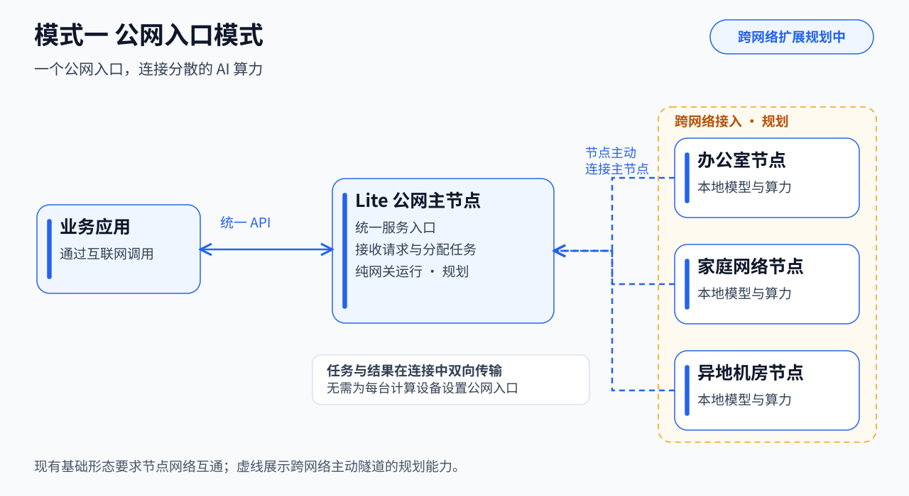
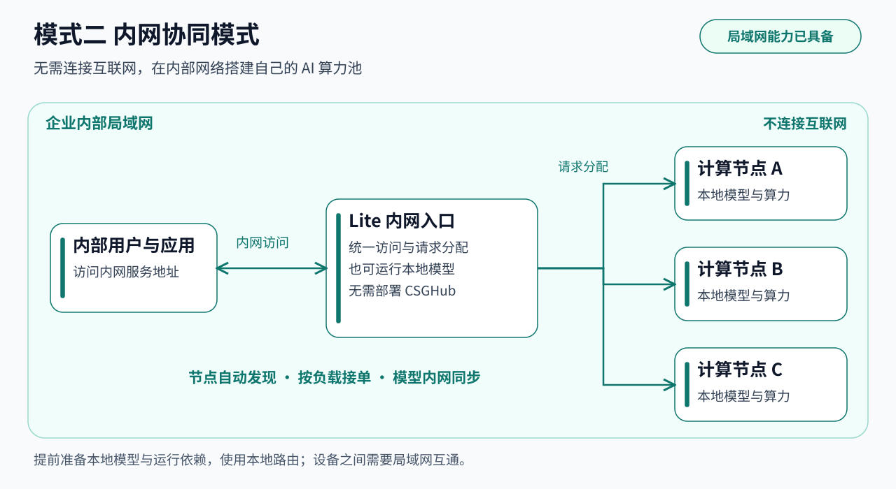
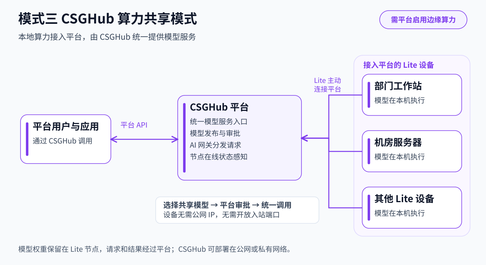

# CSGLite 企业算力协同三种部署模式

面向市场宣传与客户交流的产品介绍。

CSGLite 将部署在电脑、工作站和服务器上的模型能力组织起来，按客户的网络环境，
提供独立对外服务、内部算力协同、接入 CSGHub 平台三种部署方式。
客户可以保留已有设备，根据服务对象和平台建设情况选择合适的模式。

| 部署模式 | 一句话理解 | 主要服务对象 |
|---|---|---|
| 公网入口模式 | 一台主节点统一对外，背后的计算节点提供模型服务 | 需要通过互联网调用 AI 的团队与业务应用 |
| 内网协同模式 | 不连接互联网，多台设备在内部网络组成算力池 | 封闭网络、内部研发与企业办公场景 |
| CSGHub 算力共享模式 | Lite 把本地模型能力接入 CSGHub，由平台统一提供服务 | 已建设 CSGHub 的企业与平台用户 |

文中的“主节点”指统一访问入口。现有局域网集群中的节点地位对等，可以指定
其中一台作为入口；“无网络”指不连接互联网，设备之间仍需局域网互通。

## 模式一 公网入口模式

**对外介绍：一个公网入口，连接分散的 AI 算力。**

### 模式说明

选择一台有公网访问入口的设备作为主节点，业务应用统一访问它提供的模型服务。
主节点负责接收请求并分配给计算节点，计算节点运行模型并返回结果。
调用方只需使用一个服务地址，无需分别连接每一台计算设备，也无需部署 CSGHub。

办公室、家庭和不同机房的节点可主动连接公网主节点，通过加密隧道接收推理请求。
主节点可只承担服务入口与调度，模型在计算节点执行。下图展示这一部署形态。

### 架构图

业务应用访问公网主节点；计算节点主动建立连接后，在连接内接收任务并返回结果。
计算节点无需公网 IP，无需开放入站端口。

### 功能点

- **统一服务入口**：多台设备使用一个访问地址，简化应用接入和服务维护。
- **集中分配请求**：根据模型所在位置和节点负载选择执行设备。
- **流式返回结果**：生成内容逐步返回，支持对话等交互场景。
- **跨网络接入**：不同地点的计算节点通过主动连接加入，无需逐台配置公网入口。
- **独立网关**：公网主节点可只承担接入与调度，无需配备 GPU 或安装模型。

### 适用场景与客户价值

适合多地办公团队、需要统一 AI 接口的业务系统，以及希望独立提供模型服务的企业。
客户可以把分散设备组织成统一服务，减少应用配置和多个服务入口的维护工作。

**宣传状态：已支持跨网络隧道接入与纯网关运行；需要配置 HTTPS 入口、节点加入凭据与推理 API Key。**

## 模式二 内网协同模式

**对外介绍：无需连接互联网，在内部网络搭建自己的 AI 算力池。**

### 模式说明

在同一个局域网内，将多台运行 Lite 的设备组成集群，指定其中一台作为日常访问
入口。员工或内部应用访问这个入口，由集群把请求交给合适的节点执行。

模型和运行依赖提前准备好，并使用本地模型路由后，推理服务可以在不连接互联网
的环境中运行。模型推理的请求与结果在内部网络中传输，无需部署 CSGHub。

### 架构图

内部用户通过局域网访问入口节点，入口节点与其他计算节点协同处理请求。
入口节点也可以运行模型，整个集群不需要公网入口。

### 功能点

- **局域网自动发现**：同一网络中的节点可以自动发现并建立集群。
- **多设备共同接单**：按模型分布和设备负载分配请求，分担多人使用时的排队压力。
- **模型在节点间同步**：已有模型可在集群节点之间复制，减少重复从外部获取。
- **节点异常隔离**：不可用节点退出新请求调度，其余可用节点继续提供服务。
- **统一查看运行状态**：查看节点、模型分布和负载，便于日常运维。

### 适用场景与客户价值

适合企业研发网、实验室、内部办公网，以及需要控制数据流转范围的封闭环境。
客户可以利用已有工作站和服务器建设内部 AI 服务，把算力协同和推理流量留在内网。

**宣传状态：局域网集群能力已具备；离线部署需要提前准备模型和运行依赖。**

## 模式三 CSGHub 算力共享模式

**对外介绍：让本地设备成为 CSGHub 的算力节点，由平台统一提供模型服务。**

### 模式说明

企业已有 CSGHub 平台时，可将运行 Lite 的设备接入平台，选择需要共享的本地模型，
提交发布申请。平台审批后，用户通过 CSGHub 的统一入口调用模型，实际推理由
对应的 Lite 节点完成。

Lite 主动连接 CSGHub AI 网关，计算设备不需要公网 IP 或开放入站端口。
CSGHub 可以按企业部署方案运行在公网或私有网络中，节点只需能够访问该平台。

### 架构图

用户访问 CSGHub，平台通过已建立的连接调用 Lite 节点。模型权重保留在节点本地，
推理请求和结果经过平台与节点之间的连接传输。

### 功能点

- **接入平台统一入口**：应用通过 CSGHub 使用已接入的 Lite 模型服务。
- **按模型申请与审批**：只开放选择并获平台批准的模型，控制共享范围。
- **节点主动连接**：适配 NAT 后的设备，减少为每个节点单独配置网络入口的工作。
- **本地执行模型推理**：模型在原设备上运行，将已有设备纳入平台的算力供给。
- **同步在线与模型状态**：平台感知节点在线、离线及模型可用状态，避免继续向失联节点派单。

### 适用场景与客户价值

适合已建设 CSGHub、希望扩充模型服务来源的企业，将不同部门或地点的设备纳入
平台统一使用。平台负责服务接入和模型发布管理，Lite 负责设备侧推理。

**宣传状态：边缘算力接入能力已具备，需要 CSGHub 部署版本启用对应的边缘算力服务。**

## 三种模式如何选择

| 对比项 | 公网入口模式 | 内网协同模式 | CSGHub 算力共享模式 |
|---|---|---|---|
| 用户访问哪里 | Lite 公网主节点 | Lite 内网入口节点 | CSGHub 平台 |
| 谁分配推理请求 | Lite 主节点 | Lite 集群入口节点 | CSGHub AI 网关 |
| 是否需要 CSGHub | 不需要 | 不需要 | 需要 |
| 网络条件 | 主节点可对外访问；计算节点能主动连接主节点 | 设备之间局域网互通，无需互联网 | Lite 节点能主动访问 CSGHub |
| 模型在哪里执行 | Lite 计算节点 | 内网 Lite 节点 | 接入平台的 Lite 节点 |
| 核心价值 | 独立提供统一 AI 服务 | 内部设备协同、内网运行 | 本地算力纳入平台统一供给 |

## 统一接入地址

Lite 对外统一推荐 AI Gateway：本地使用 `http://localhost:11435/ai-gateway/v1`，公网模式使用 `https://<主节点地址>:8080/ai-gateway/v1`，内网模式替换为入口节点的地址。客户端使用已发布的模型服务 ID，无需知道 Provider 或计算节点地址。Anthropic 客户端的 Base URL 使用同一入口的 `/ai-gateway`。旧直连路径仅作兼容，不再宣传。

CSGHub 算力共享模式使用平台提供的 API 地址，不把 Lite 的路径套用到 CSGHub 主站或其他上游 Provider。

## 宣传口径

三种模式可以概括为：**独立对外服务、内部算力协同、平台算力共享。**
它们是三种部署场景，不是三个需要分别安装的 Lite 产品。

- “汇聚算力”表示多台设备共同处理不同请求，不表示将多台设备的显存合成一块，
  也不承诺每一条请求都能按节点数量等比例加速。
- “模型在本地执行”说明推理发生的位置。公网和 CSGHub 模式的输入与结果会经过
  服务入口，不能表述成“所有数据始终不离开设备”。
- 本介绍面向企业方案；现有社区版也支持小规模使用。集群社区配额为 2 个节点，
  边缘算力社区配额为每台设备共享 1 个模型，企业扩容按有效授权执行。
- 公网模式的控制台登录 Token 与模型推理 API Key 分别管理，不与 CSGHub 账号混用。

内部参考：[公网集群需求](public-cluster-requirements.md)、
[局域网集群说明](../../ee/README.md)、[功能与配额定义](../../internal/license/features.go)。
