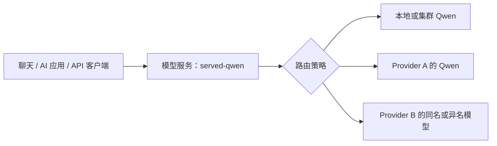

# 模型服务管理

AI 网关默认进入「模型服务」。Provider 管理连接和凭据；模型服务管理应用调用的名称、模型来源及路由策略。

## 发布流程

1. 在 Provider 页面配置连接并点击「发布模型」，或从「模型服务」直接选择本地、集群模型。
2. 同步候选目录，选择创建独立服务或加入已有服务。同步目录本身不会发布模型。
3. 设置显示名称及唯一调用名称，例如 `served-qwen`。应用通过 `model` 字段传入调用名称。
4. 添加多个来源时，确认版本、量化、上下文、输入输出类型及工具能力可以互换。同名模型不会自动合并。
5. 保存后，在服务的 API 弹窗查看调用地址和示例。点击模型行的「更多 → 推理测试」，按 API 类型发送单次请求并查看结果。独立 Chat 页面已移除。

来源用 Provider 的固定 ID 和模型 ID 标识，Provider 改名不影响绑定。服务支持对话和向量化，其他能力继续使用原有专用入口。

## 路由与状态

| 策略 | 行为 |
| --- | --- |
| 固定来源 | 仅绑定一个来源，不自动切换。 |
| 故障切换 | 新服务默认策略，按优先级从小到大尝试，同优先级保留配置顺序。 |
| 按权重分配 | 新会话按权重分配，已有会话优先沿用成功来源。 |
| 优先级 + 权重 | 保留原模型池的分组、加权与回退规则。 |

故障切换只针对可重试错误；流式输出开始后不会切换来源拼接结果。来源可独立停用并配置请求、Token 和并发限额。关闭 Provider 保留绑定，其他来源仍可使用。没有可用来源返回 503，所有可用来源达到限额返回 429。

「已配置」不代表上游健康。点击每个模型行的「更多 → 推理测试」打开单次 API 测试弹框，模型固定为当前服务。对话服务可测试 Chat Completions、Responses 或 Messages；向量化服务调用 Embeddings。输入测试内容后展示返回结果、HTTP 状态和耗时，支持取消请求；不保存聊天历史。推理测试和应用列表优先显示服务，并隐藏相同来源、相同模型的重复项；推理测试当前已选中的直连模型保留，其他 Provider 的同名模型也保留。

## 配置与兼容

继续复用 `provider_pools.json` 和 `/api/provider-pools`，不引入第二份服务配置。原 ID、成员和缺省 `priority_weight` 策略保留，新 UI 为新服务显式选择 `failover`。

新增 `category` 声明对话或向量化能力。服务名称不能代表能力，尤其候选模型尚未加入旧直连目录时；旧配置省略该字段时保留原来的对话目录展示。成员新增 `disabled` 用于单独停用绑定，省略时仍启用。响应中的 `source_states` 为实时计算的配置状态，不持久化。这些字段均有配置往返及兼容测试。

模型 ID 在模型服务之间唯一，但可以与底层来源模型同名；不同 Provider、节点的来源模型 ID 可以重复。添加模型时默认沿用来源的完整模型 ID。多个来源需要绑定到同一个服务，不自动合并同名来源。所有模型服务统一使用 `/ai-gateway/v1`，通过对外调用名称选择服务。`GET /ai-gateway/v1/models` 仅展示已启用且有配置来源的服务，不同步候选目录。统一入口始终解析模型服务，不会因其他 Provider 出现同名模型而改变调用来源。

对外文档、API 示例与 SDK 配置统一推荐 `/ai-gateway/v1`；Anthropic 客户端的 Base URL 为 `/ai-gateway`。Provider 连接页和本地模型页的 API 弹框使用已发布的服务 ID；尚未发布时提示先发布服务。内部直连测试与旧客户端保留来源隔离，旧 `/v1/*`、`/providers/*` 不再作为推荐入口。

集群模型也使用同一个入口：服务的成员来源选择整个集群或指定节点，调用方不需要知道节点地址。停止共享或节点离线时请求返回明确错误，不回落到同名的其他 Provider。

请求中 `model` 填写已发布的模型服务 ID，不填写 `source`。`source=cluster` 或
`source=node:<uuid>` 仅供旧直连兼容入口使用；在统一入口指定来源会返回 400，
需要改为在服务成员中配置来源。公网示例见[公网集群调用接口](public-cluster-requirements.md#调用接口)。

设计讨论：[Issue #253](https://github.com/OpenCSGs/csglite/issues/253)。
