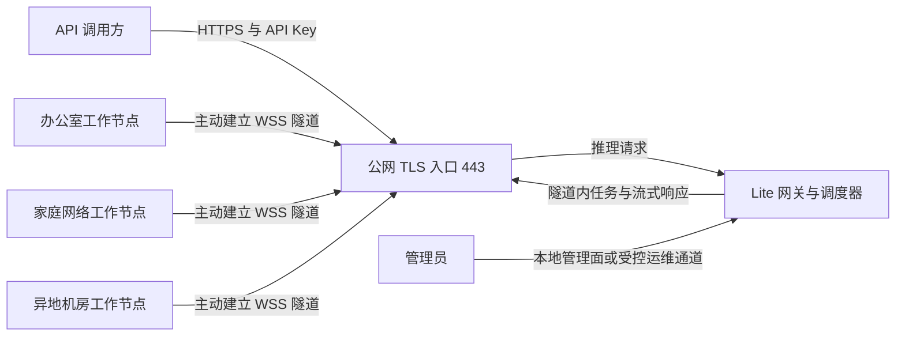

# 公网算力集群需求与方案设计

状态：初期设计草案归档。本文保留实现前的需求和拟议契约，不代表当前功能；已交付能力与实际命令以[公网算力集群使用指南](public-cluster-requirements.md)为准。

让一台具备公网入口的 CSGLite 作为网关，接入分布在不同网络中的计算节点，
并向调用方提供统一的推理 API。计算节点主动建立出站隧道，无需公网 IP、
端口映射或相互连通；公网网关可以不安装模型、不运行推理引擎。

第一期采用单网关、多工作节点的星形结构，复用现有集群调度和边缘算力隧道的
基础能力，不依赖部署 CSGHub Server。局域网集群继续保留现有行为。

## 1 背景与需求

### 1.1 典型场景

团队在云服务器部署一个公网入口，把办公室、家庭宽带、不同机房和移动网络中的
CSGLite 设备接入同一个算力池。调用方只配置一个 API 地址和 API Key；节点
重启、切换网络或公网出口 IP 变化后自动恢复服务。

这里的“任意节点”指经过授权的 CSGLite 节点，网络位置不限；加入后只有节点
所有者明确共享的本地模型能够被调用。

### 1.2 当前能力与缺口

| 项目 | 当前实现 | 本次新增需求 |
|---|---|---|
| 集群结构 | 局域网内的对等成员，任意成员可作为入口 | 增加一个网关负责公网接入和调度的模式 |
| 节点发现 | mDNS、静态种子、指定地址 | 节点使用明确的网关 HTTPS 地址主动接入 |
| 请求转发 | 入口主动直连目标节点的集群端口 | 网关通过节点已建立的出站隧道发起调用 |
| 节点身份 | 持久化 UUID 和证书，地址可变化 | 保留节点身份，增加网关侧准入与节点凭证 |
| 现有边缘算力 | Lite 通过隧道向 CSGHub AI 网关贡献模型 | Lite 自身也能承担隧道服务端和统一推理入口 |

现有 `cluster join --address` 可以指定目标地址，但不提供 NAT 穿透或反向隧道。
完成加入握手不能证明入口能回连计算节点。

## 2 目标与范围

### 2.1 第一阶段必须交付

1. 网关和工作节点使用同一个 CSGLite 安装包，按运行角色启用能力。
2. 工作节点只需能通过 TCP 443 访问网关，不要求开放入站端口或支持 UDP。
3. 网关支持节点准入、模型聚合、按负载调度、流式推理和故障隔离。
4. 支持节点审批、凭证撤销、停止接单、维护和移除，状态在 Web UI 和 CLI 一致展示。
5. 节点断网、睡眠、重启和网关重启后能够恢复连接；撤销的身份不能自动恢复。
6. 公网访问必须鉴权，隧道只能承载批准的推理操作，不能代理本机管理接口。
7. macOS、Linux 和 Windows 工作节点均可接入，包含桌面客户端运行方式。

### 2.2 分期边界

| 能力 | 第一期 | 后续阶段 |
|---|---|---|
| 单网关接入多个跨网络节点 | 必须 | 持续优化 |
| 网关同时参与本地推理 | 可选启用，默认关闭 | 保持 |
| 纯网关部署，无 GPU、无推理引擎 | 必须 | 保持 |
| 多网关自动选主、无中断切换 | 不包含，明确网关是单点 | 评估独立高可用方案 |
| 局域网节点与公网节点混合调度 | 不包含，同一实例选择一种集群拓扑 | 评估统一成员目录和传输选择 |
| 工作节点同时充当其他客户端的集群入口 | 不包含，统一从网关调用 | 按需要扩展 |
| 跨公网模型文件复制或远程下载任务 | 不包含，节点自行下载并选择共享模型 | 独立设计带宽、授权与断点续传 |
| 单模型跨机器切分、显存池化 | 不包含 | 独立评估 |
| 多租户隔离、计费、收益结算、公共算力市场 | 不包含 | 沿用 CSGHub 产品方向评估 |
| 接管节点文件、终端、安装器、应用管理 | 不包含 | 不属于推理隧道职责 |

## 3 角色与网络结构

| 角色 | 职责 |
|---|---|
| 网关 Gateway | 公网推理入口、节点准入、模型目录、调度、隧道会话和集群运维 |
| 工作节点 Worker | 主动连接网关，上报状态，在本地执行批准的推理请求 |
| 管理员 | 在网关本地管理面创建邀请、审批节点、配置可调用模型和流量上限 |
| API 调用方 | 携带推理 API Key 调用网关，无需知道节点网络地址 |



箭头中的 WSS 表示连接由工作节点发起。连接建立后双向传输，网关在隧道中
打开逻辑连接下发请求，工作节点返回结果；网关不连接节点的公网或内网 IP。

第一期一个集群只有一个网关，一个工作节点最多属于一个集群。网关不向工作节点
分发其他节点的私网地址，也不要求工作节点交换成员 gossip。网关保存权威成员表，
工作节点只保存自己的加入关系以及用于配额判定的成员总数和成员版本。

### 3.1 公网入口与管理面

第一期支持在网关前部署 TLS 反向代理，使用域名及可信证书对外提供 443；Lite
的公网业务 handler 绑定回环地址，经反向代理访问。反向代理需支持 WebSocket
升级和流式响应，不能缓冲 SSE，也不能用普通短请求超时截断推理流。

公网业务 handler 与完整管理 handler 分开注册，采用显式路由白名单。公网只
承载推理、准入和隧道连接；管理页面、配置、License、文件和应用操作仍走现有
管理面。仅在代理侧屏蔽路径不构成服务端的权限隔离。

公网业务 handler 无论 TCP 对端是否为回环地址，都必须执行公网鉴权，不能复用
本地请求免鉴权的判断。反向代理来自本机也不代表调用方可信；只接受明确配置的
代理所提供的转发地址，不能用调用方自带的转发头绕过鉴权或限流。

工作节点在公网模式下不启动 mDNS，不因接入网关而开放 `11438`。桌面端现有
`11436` 无鉴权推理接口不能用作公网入口；本地开发预览仍只使用
`http://localhost:11435`。

只有公网 IP、没有域名的部署，也必须使用受客户端信任且匹配该 IP 的证书，或
显式配置私有 CA。生产接入不允许以跳过证书校验解决证书问题。

## 4 节点接入与成员生命周期

### 4.1 创建网关

管理员选择“公网网关”，设置集群名和对外 HTTPS 地址，配置推理 API Key、
并发和队列上限。系统检查 TLS 对外配置、必要鉴权和本机端口，展示部署检查结果。
默认关闭网关本机接单；缺少模型或推理引擎不能阻止网关启动。

已有局域网集群不能隐式变成公网集群。切换模式必须先退出原集群并明确重新创建
或加入，保留节点 UUID；不得自动继承旧共享密钥或旧集群的信任关系。

### 4.2 邀请与审批

1. 管理员生成邀请，包含网关 URL、集群 UUID、随机邀请密钥、有效期和允许次数。
   默认有效期 15 分钟、允许 1 台节点，支持立即撤销。多次邀请必须显式指定次数。
2. 节点所有者在本机输入邀请，确认目标网关和准备共享的模型后提交申请。首次默认
   不共享任何模型；界面必须说明所选模型的输入内容将在本机执行。
3. 网关验证邀请、协议、集群身份和节点 UUID，记录待审批申请。默认需要管理员
   审批；节点取得仅能查询自身结果的申请凭证。批量部署可创建明确标为“自动批准”的受限邀请。
4. 审批时原子检查成员配额、节点自身许可上限和邀请剩余次数，绑定成员身份与
   节点专用凭证。只有加入成功才计入成员；失败和待审批申请不占正式成员配额。
5. 节点使用专用凭证建立隧道，完成首份状态同步后进入可调度状态。凭证不能用于
   创建邀请、管理集群、调用其他节点或调用公网推理 API。

邀请与注册请求必须具备幂等性：相同节点重试、审批响应丢失和网关重启均不能
重复创建成员或重复消耗邀请次数。待审批数量设独立上限，过期自动清理。
审批期间节点可以退出并取消申请；所有邀请和节点凭证均不得出现在 URL 查询参数中。
批准后工作节点凭申请凭证安全领取隧道凭证，交接可恢复且不可被其他节点领取；
申请凭证始终不具有建立隧道或发起推理的权限。

### 4.3 重连与身份恢复

加入邀请只用于首次准入。成功加入后使用持久化节点凭证重连，无需重新审批、
重新消耗邀请或重新占用节点配额。重装后若没有恢复原身份，视为新设备，不能仅靠
相同主机名取代旧成员。

同一 UUID 同时只允许一个有效隧道。已认证的新连接就绪后替换旧连接，旧连接
不能再接受新请求。网关使用会话代次区分连接，迟到的旧心跳和旧连接关闭事件
不得覆盖新连接状态。持续来回替换须展示身份可能被复制的告警。

### 4.4 节点状态与撤销

将准入状态、连接状态和接单状态分开表达，避免“在线”等同于“可用”。

| 维度 | 状态 | 调度含义 |
|---|---|---|
| 准入 | 待审批、已批准、已拒绝、已撤销 | 只有已批准节点可能接单 |
| 连接 | 连接中、在线、重连中、离线 | 隧道有效且遥测新鲜才接单 |
| 接单 | `active`、`drain`、`maintenance` | 沿用现有含义；只有 active 接新请求 |
| 模型 | 未共享、冷模型、已加载、不可用 | 已共享且能力匹配的模型才进入候选 |

节点所有者可在本机停止共享、drain、退出集群，网关管理员也可对成员停止派单或
移除。本机停止共享优先于网关指令。drain 等待在途请求完成；强制移除立即取消
在途请求并撤销凭证。maintenance 不接新请求，已有请求的处理采用 drain 语义。

撤销结果持久化，不能因重连、重启或旧成员快照恢复。重新接入必须使用新邀请
并完成新的准入流程；旧凭证永久失效。仅轮换邀请不应踢出已批准节点。

## 5 模型与推理行为

### 5.1 模型发布

工作节点只上报本机明确共享且已下载完成的模型，包含模型来源、仓库、版本或
文件摘要、量化、模态能力、加载状态、上下文上限及并发容量。网关管理员可在
节点共享范围内进一步关闭某模型；不能远程扩大节点所有者的共享范围。

网关聚合模型列表，隐藏本机文件路径。公网 `/v1/models` 只展示当前可调度模型，
管理面保留离线或不可用记录并显示原因。同名模型的来源、版本、量化或能力不同
时不能静默当作等价副本；必须显示冲突并配置不同的对外别名。

第一期不通过隧道同步模型权重、不接受远程下载命令。节点自行准备模型，变更
后立即同步模型目录；其他工作节点不能利用该通道读取模型或任意文件。

### 5.2 接口范围

| 接口族 | 第一期支持范围 |
|---|---|
| OpenAI 兼容 | `/v1/models`、chat completions、embeddings、现有无服务端持久会话的 Responses 用法 |
| Anthropic 兼容 | messages 和 count tokens，包含流式输出 |
| Ollama 兼容 | `/api/chat`、`/api/generate`，包含流式输出 |
| 音频转写与语音合成 | 第二期，单独验收上传限额、二进制响应和取消 |
| 图像生成、Realtime、其他路径 | 第一期不承诺，明确返回不支持 |

不能因为底层代理能够转发任意 HTTP，就默认新增接口已受支持。隧道两端使用相同
的方法与路径白名单，并验证请求模型属于该节点的有效共享集合。Responses 的
远端状态恢复、后台任务和依赖 `previous_response_id` 的服务端会话不在第一期范围。

### 5.3 路由契约

| 请求来源 | 行为 |
|---|---|
| 公网网关业务入口省略 `source` | 使用公网集群调度，默认 balanced |
| `source=cluster` | 在公网集群可用候选中选择 |
| `source=node:<uuid>` | 固定到授权集群内的指定节点；不可用时失败，不改投其他节点 |
| `source=local` | 仅网关本机；纯网关或本机接单关闭时明确报错 |
| `source=cloud`、`provider:*`、`pool:*` | 不纳入首期公网业务白名单，明确报不支持，不回落本地或集群 |

以上默认值只作用于新启用的公网业务入口。现有单机、局域网集群和工作节点本地
接口保持既有行为。工作节点本地接口在第一期不代理公网集群请求，显式请求
`cluster` 或 `node:*` 时说明应使用网关地址。

网关下发的任务固定在目标节点本地执行，不能再次转发到集群、云服务或 provider，
防止路由循环和意外外发。公网 Key、节点凭证、本机凭证三者独立。

### 5.4 调度与限流

候选先满足准入、隧道健康、遥测新鲜度、许可、接单状态、模型身份和能力等条件，
再复用现有调度器，根据加载耗时、排队、实测速度、内存压力和热降频排序。
公网模式增加隧道 RTT、最近失败率及传输耗时估计，避免快 GPU 被慢链路拖累。
估计值必须能在 `explain` 中解释；未知网络性能使用保守默认值。

网关按 API Key、集群、节点实施并发与请求速率限制，节点仍有独立硬并发上限。
可用槽位在派单时原子预留，重连不能重置到无限容量。第一期队列必须有长度和
等待时限，不能无限积压；节点负载变化不承诺提升每条请求的速度。

拟定初始默认值为全局并发 32、单 Key 并发 8、单节点并发 4、全局等待队列 64，
均可由管理员调整。节点有效并发取网关上限和本机上限的较小值；待审批申请上限
默认 100，满额拒绝新申请但不影响已加入成员重连。

沿用 `X-CSGLite-Thread-ID` 会话亲和，作用域至少包含 API Key 身份，防止不同
调用方使用相同线程 ID 影响彼此路由。亲和节点不可用时允许重新选择并丢失缓存；
完整消息历史仍由调用方提供，不承诺迁移节点 KV cache。

### 5.5 流式输出与重试

SSE 和 Ollama 流逐段转发，不收集完整结果后再响应。慢客户端必须产生有界背压，
不能无限缓存，也不能长期阻塞同一节点的控制心跳。客户端断开、超时或取消时，
网关关闭对应流并传播取消，释放队列与预留槽位。

请求尚未交给节点执行，或节点明确拒绝执行时，可以换候选。对执行状态不明的
断线请求，第一期不自动重放，返回可识别的失败；不能把“尚未收到响应头”等同于
“节点没有执行”。请求 ID 用于追踪，不提供跨网关重启的 exactly-once 保证。

一旦响应头或正文已经对客户端提交，失败时终止响应并标记流未正常完成，不能
拼接另一节点的输出或伪造正常结束事件。调用方自行决定是否重新请求。

## 6 隧道方案与实现参考

### 6.1 参考已有的 CSGHub 隧道

开发时优先参考同级仓库 `../starhub-server` 的
`aigateway/component/edgeserving/`，以及本仓库 `ee/edge/`。
参考基线为 starhub-server 本地提交 `1f4e061f8`；具体行为以开发时的实现和测试为准。

| 参考位置 | 已有机制 | 本需求的复用方向 |
|---|---|---|
| starhub-server 的 `tunnel_ee.go` 与 Lite 的 `ee/edge/tunnel.go` | WebSocket 字节流适配、yamux 多路复用、JSON 行控制消息 | 沿用 WSS 加 yamux 的传输方式和控制流结构 |
| starhub-server 的 `hub_ee.go` | 会话目录、首份状态握手、心跳超时、会话替换、隧道内 HTTP transport | 提取适合单进程网关的会话生命周期逻辑 |
| starhub-server 的 `relay_ee.go` | 隧道请求代理、即时刷新、路由和请求头白名单 | 参考流式代理、凭证隔离和断流行为 |
| starhub-server 的 `service_ee.go` 与 `aigateway/handler/edge_serving_ee.go` | 节点专用令牌、哈希保存、连接鉴权、禁用节点 | 参考凭证管理与升级连接前校验 |
| starhub-server 的 `edge_serving_ee_test.go` | 心跳失联、禁用、重连、响应头前后断流等测试 | 转化为 Lite 的隧道验收和回归场景 |
| Lite 的 `ee/cluster/scheduler.go`、`engine_cluster.go` | 模型过滤、负载排序、会话亲和、故障隔离 | 通过传输接口接入公网候选，保持一套调度实现 |

CSGHub 当前服务端还包含数据库、Redis、跨副本 relay、模型申请、账户和结算等
依赖；Lite 单网关模式不引入这些基础设施。不能直接 import 整个服务端组件，
也不照搬跨副本路由和计费流程。其 EE/SaaS 源码不直接复制到公开代码；可复用的
具体代码需先明确授权归属，优先使用 Lite 已有的隧道基础和协议经验。

现有两端的路径白名单并不完全相同。公网集群必须按第 5.2 节重新定义共同白名单，
使用独立协议版本与能力协商；不能因为同为 yamux 就把现有 edge 客户端当作
公网集群客户端。现有 CSGHub edge 接口和认证保持兼容。

### 6.2 传输与认证边界

一个工作节点保持一条 WSS 连接，通过 yamux 承载控制流和并发请求。节点先打开
控制流，上报完整状态；网关确认后才开放任务流。任务在逻辑连接内使用 HTTP
请求与响应，支持连接复用；逻辑流关闭必须最终取消对应节点请求。

WSS 使用可信 TLS 校验网关，节点专用凭证绑定集群 UUID 和节点 UUID。公网模式
以专用凭证鉴权，不把请求体里自报的证书指纹当作私钥持有证明；LAN 原有 mTLS
保持独立。TLS 终止代理到 Lite 只通过回环或明确受信的私网链路传输。

网关凭证库存只保存哈希，工作节点凭证保存在存储根下并限制文件访问权限。
管理员可以轮换节点凭证，轮换成功后旧凭证和旧会话失效；丢失新凭证响应时必须
有安全的恢复或重新准入流程，不能让节点永久占位且无法恢复。

控制流包含协议版本、会话代次、成员版本、心跳周期、模型目录、遥测和接单状态。
完整快照在连接建立或版本失配时同步；增量消息必须单调编号。协议主版本不兼容
时在准入或连接阶段拒绝并提示升级，不进入循环重连。

## 7 故障与恢复要求

以下时间均为第一期拟定默认值和验收目标，限额在实现时集中定义。

| 情况 | 要求 |
|---|---|
| 正常运行 | 每 5 秒上报应用层心跳与必要遥测；传输 keepalive 不能替代模型状态刷新 |
| 明确断开 | 网关在 1 秒内将该会话从新请求候选中剔除 |
| 网络黑洞或节点无响应 | 连续 15 秒无有效应用心跳后剔除；不能仅凭 TCP 仍连接判定在线 |
| 节点恢复网络 | 按 1、2、4、8 秒递增并封顶 30 秒的退避重连，增加随机抖动；稳定后重置 |
| 网关可达且网络稳定恢复 | 60 秒内恢复新请求调度，含重连和首份状态同步 |
| 网关重启 | 恢复准入与撤销记录，在线状态从空开始，节点重连并完整同步后再上线 |
| 网关宕机 | 客户端失败；工作节点本地推理仍可用，第一期不自动切到其他网关 |
| 认证失败、撤销或配额不满足 | 停止快速重连，显示需操作的原因；不能自动注册绕过撤销 |
| 模型停止共享 | 先在本机停止接新请求，推送变更；网关删除候选，在途请求按 drain 完成 |
| 集群许可缩减 | 不静默驱逐成员；保留管理和撤销能力，按第 10 节停止不合规派单 |

首次连接和控制流握手默认最多等待 15 秒；遥测超过 15 秒未刷新不得派新单。
默认排队最多 30 秒，单条请求总时限 10 分钟，可由管理员调整。没有生成 token
不代表失联，长 prefill 期间仍须上报心跳。

## 8 用户界面与接口草案

### 8.1 页面与操作

在现有“算力集群”入口选择局域网集群、公网网关或连接公网网关。使用已有集群
的实例显示当前模式及明确的切换流程；不让用户分别维护两份同义设置。

网关页面展示入口 URL、成员数与授权上限、待审批申请、节点状态、可调用模型、
并发、排队、隧道 RTT、最后心跳、重连原因和近期错误。网关本机接单作为独立
开关；节点在线但不接单时必须显示具体原因。

工作节点页面展示目标网关、审批和连接状态、共享模型、在途请求、停止接单和
退出操作。CLI 与页面调用同一管理 API；桌面模式隐藏仅适合服务器的公网部署
控制，但保留连接网关、模型共享和本机接单控制。

### 8.2 拟议命令

下面仅表达交互契约，不是当前可执行命令；命名在 CLI 实现时统一。

```text
csghub-lite cluster create --mode public --public-url https://gateway.example.com
csghub-lite cluster invitation create --expires-in 15m --uses 1
csghub-lite cluster join --gateway https://gateway.example.com --invitation-stdin
csghub-lite cluster approve <node-uuid>
csghub-lite cluster share <local-model-id>
csghub-lite cluster unshare <local-model-id>
csghub-lite cluster nodes --json
csghub-lite cluster models
csghub-lite cluster explain <model>
csghub-lite cluster drain
csghub-lite cluster remove <node-uuid>
```

邀请和节点凭证通过本地交互、标准输入或受保护文件传入，避免明文出现在命令
参数、终端历史或进程列表。新增选项不改变已有 LAN 命令含义。

### 8.3 拟议 HTTP 边界

| 面向对象 | 路径草案 | 用途和认证 |
|---|---|---|
| API 调用方 | 第 5.2 节的推理路径 | 强制推理 API Key，按 Key 限流 |
| 首次接入节点 | `POST /cluster/v1/enroll` | 邀请验证、注册幂等、创建申请，不授予推理权限 |
| 已申请节点 | `GET /cluster/v1/admission` | 申请凭证，只能查看自身申请结果 |
| 已批准节点 | `POST /cluster/v1/credential` | 申请凭证与恢复校验，安全领取或恢复自身隧道凭证 |
| 已批准节点 | `GET /cluster/v1/connect` | 节点专用凭证，升级为 WSS，检查协议与撤销状态 |
| 本机管理员 | `/api/cluster/*` 的增量扩展 | 现有管理鉴权加管理员范围；邀请、审批、移除、配置和节点诊断 |

普通推理 Key 不能执行管理操作，节点凭证不能调用推理入口。第一期管理面不对
公网业务监听器挂载；具体方法、schema 和错误 envelope 在实现时写入
`openapi/local-api.json`，同步内嵌副本并执行 `go test ./internal/server`。

错误必须可被客户端区分：认证失败为 401，无权限或许可不足为 403，身份或
协议冲突为 409，请求体过大为 413，明确不支持的路径为 404，限流或队列已满为
429，无可用计算节点为 503，执行状态不明的隧道错误为 502，总时限到期为 504。
遵循现有接口族的错误结构；License 拒绝继续使用 `feature_not_licensed` 以及
现有 `feature`、`edition_required` 字段，不新增另一套 License 错误。

## 9 配置与数据归属

现有配置已经包含 `config.json` 的 `cluster` 配置段（Secret、Name），以及
`cluster/cluster.json` 的成员、Settings、静态地址和撤销记录。新增配置需复用
这些所属结构，禁止再增加平行的 `public_cluster`、`gateway_cluster` 顶层真源。

| 数据 | 建议唯一归属 | 说明 |
|---|---|---|
| 部署角色、网关 URL、公网业务监听地址 | 现有 `config.json.cluster` 的类型化扩展 | 部署配置；环境变量仅覆盖有效值，不重复写入另一份状态 |
| 集群身份、拓扑、成员、审批、邀请哈希、成员版本、共享策略 | 扩展现有 `cluster/cluster.json` | 集群业务状态由一个管理器原子写入，拓扑不能独立改成不同值 |
| 节点 UUID、证书、私钥 | 复用现有 `cluster/` 身份文件 | 角色改变不自动重建身份 |
| 节点访问凭证 | 存储根下独立的受保护凭证文件 | 便于限制权限；成员表只引用凭证记录，不重复保存明文 |
| 活跃连接、RTT、队列、在线遥测 | 内存 | 不将过期运行态当作重启后的在线依据 |
| 运维事件和追踪 | 存储根下的日志与现有可观测性设施 | 控制保留量，不记录邀请、凭证、提示词和模型输出正文 |

公网模式扩展现有集群 schema version；没有新字段的历史文件继续加载为 LAN。
部署角色与持久化拓扑冲突时启动报可操作的配置错误，不能静默覆盖集群身份。
新增持久化字段必须说明已有结构为何不能表达，并提供往返、兼容加载与原子保存
验证。旧版本不能识别的公网状态应拒绝降级启动，不得当作 LAN 重写丢失审批记录。

所有日志、缓存、请求暂存与子进程临时文件均位于配置存储根，默认
`~/.csghub-lite`。文件权限在 Unix 和 Windows 使用各自适配方式实现。

## 10 版本与授权设计

第一期建议沿用 `quota.lite.max_cluster_nodes`，不新增重叠的公网节点配额，
不回收已发布的 LAN 或 edge 功能。社区版总计 2 个成员，企业版按签名 License
中的配额执行，未指定上限时为不限。

计数包括网关本身，即使它不承担推理；社区版可以运行“1 个网关 + 1 个工作
节点”。离线和 drain 成员仍占配额，移除后释放集群成员配额。重复重连不增加
计数，多个并发审批必须在同一原子操作中预留配额。

沿用当前各节点自行判断许可的规则：超过 2 个成员时，网关和参与服务的节点
都需要能够覆盖集群规模的本地有效许可，网关 License 不自动传播到工作节点。
扩容前检查既有节点和新节点上限，提示需升级许可的节点，避免先扩容再导致
原有节点全部退出调度。成员总数由网关通过认证控制流同步，工作节点据此判定。
既有节点缺少可验证的许可摘要时，扩容停留在待核验状态并显示节点名单，不能
先增加正式成员再等待这些节点上线。

运行中许可失效或配额下调时，超限状态不接新请求；已有推理允许完成，管理、
查看和移除保持可用，恢复合规后重新调度。不得只按在线节点数放行超限集群。

`quota.lite.max_devices` 是每份 License 的设备激活限制，当前为 5，和集群
成员配额分别处理；集群成员移除不释放 License 的设备激活名额。“集群不限”
不能被界面表述成“同一 License 可无限激活设备”。

若产品后续要求网关统一授权、工作节点免独立导入 License，需另行设计授权委托
和设备核销，不在这次隧道需求中隐式实现。新 EE 代码放入 `ee/` 并带规定文件头；
通用隧道抽象如需进入 Apache 部分，须独立确认代码来源和授权。

## 11 容量与可观测性

第一期验收基线为 1 台纯网关、10 台已授权工作节点和 32 条并发文本推理，持续
30 分钟。参考网关使用 4 vCPU、8 GiB RAM、100 Mbps 链路；测试注入网关与工作
节点间约 100 ms RTT 和 10 Mbps 单节点带宽，并记录模型、输入和输出长度。
这是拟定验收负载，不代表已测得的产品容量上限。

默认单条推理请求体上限 32 MiB，首期控制消息上限 1 MiB；控制消息按节点限频。
单节点最大并发须协商，并同时受网关设置和节点本机设置限制，不能信任节点上报
的无限并发。慢读、无结束请求和超大模型清单不能导致无界内存或 goroutine 增长。

稳定网络、模型预热且未超容量时，验收期间不能出现隧道引入的请求失败。报告
成功率、TTFT、端到端时延、网关内调度与代理开销、CPU、RSS 和传输字节量；
冷启动和主动故障注入单独统计，不把模型加载耗时归入纯代理开销。性能验收
门槛在首轮基线测试后收敛，不预设多节点必然线性提速。

至少记录准入、审批、撤销、会话更替、心跳超时、drain、配额拒绝和请求结束。
请求保留现有关联 ID、Trace ID 和内部会话亲和关联；对工作节点只转发必要的
不透明追踪标识与 API 协议头，不转发调用方 Authorization、Cookie 或账户信息。
响应沿用 `X-CSGLite-Node` 等节点标识，禁止在响应中泄露私网地址和凭证。

## 12 验收场景

| 编号 | 场景 | 验收结果 |
|---|---|---|
| A01 | 家庭 NAT 节点阻断全部入站，仅允许出站 443 | 完成准入，调用方通过网关获得流式结果 |
| A02 | 两个工作节点彼此完全不可达 | 均能接单，不发生网关主动回连私网地址 |
| A03 | 无 GPU、无模型、无推理引擎的网关 | 正常启动并调度远端推理 |
| A04 | 无效、过期、撤销或次数已用完的邀请 | 拒绝准入，不新增正式成员 |
| A05 | 节点待审批、审批通过、审批拒绝 | 状态一致；只有批准且初始同步完成后才能接单 |
| A06 | 重复注册、审批响应丢失、并发审批抢最后一个名额 | 幂等恢复、不重复计数、不突破配额 |
| A07 | 同 UUID 重连时旧连接迟到或关闭 | 新会话保持在线，旧会话不能继续接新单 |
| A08 | 节点重启、换 IP、睡眠恢复或网关重启 | 稳定可达后 60 秒内恢复，身份和共享选择保留 |
| A09 | 网络黑洞，TCP 未立即断开 | 15 秒无应用心跳后停止派单，其他节点继续服务 |
| A10 | 明确断线和慢客户端阻塞输出 | 1 秒内排除断线会话；慢读不阻塞控制心跳或造成无界缓存 |
| A11 | 节点被撤销后重连及网关重启 | 旧凭证持续拒绝；新邀请重新批准才能恢复 |
| A12 | 未共享模型、撤回模型、模型身份冲突 | 不越权调用，不静默混用不同版本和量化 |
| A13 | 冷模型与热模型、不同负载和链路质量 | 分配可解释；模型不匹配节点无请求 |
| A14 | 首 token 前执行状态不明的断流 | 返回明确失败，不自动重复执行 |
| A15 | 已开始响应后隧道断开 | 流异常结束，不拼接其他输出，不伪造成功结束 |
| A16 | 客户端取消、排队超时、推理总超时 | 下游取消并释放槽位，超时状态可区分 |
| A17 | 节点本机停止共享、网关 drain、强制移除 | 遵守本机共享边界和第 4.4 节的在途请求语义 |
| A18 | 请求尝试管理路径、任意 URL、路径编码绕过或伪造 source | 两端白名单和本地执行约束均拒绝越权 |
| A19 | 公网推理 Key 调用管理面，节点凭证调用推理入口 | 均拒绝；管理路由不在公网业务 handler 中 |
| A20 | 超大请求、超限控制消息、重连风暴、满队列 | 有界拒绝，进程稳定，已接纳请求不受无限积压影响 |
| A21 | 社区 2 节点、增加第 3 节点、许可缩减 | 符合第 10 节；预检扩容，拒绝超限，保留恢复入口 |
| A22 | macOS、Linux、Windows，含桌面方式启动 | 完成接入、共享、取消、重连和退出，身份文件位置正确 |
| A23 | 旧配置、旧 LAN 集群和既有 CSGHub edge 连接 | 原行为保持，未启用公网模式不增加监听和连接 |
| A24 | 协议版本不兼容、证书错误和反向代理升级失败 | 可操作错误提示，不假在线、不跳过 TLS、不无限快速重试 |

## 13 实施划分与评审事项

| 阶段 | 交付内容 | 完成条件 |
|---|---|---|
| 一 | 梳理 starhub-server 与 Lite 的可复用边界，固化协议和配置 schema | 双端消息、取消语义、许可预检与兼容策略可测试 |
| 二 | 纯网关监听器、邀请审批、节点凭证、出站隧道与重连 | 通过最小文本调用验证 A01 至 A11、A19、A24，无需 CSGHub 依赖 |
| 三 | 调度、模型目录、文本接口族、流式输出、背压和限流 | 文本功能及故障场景通过，完成容量基线 |
| 四 | Web UI、CLI、授权展示、三平台验证和部署文档 | 全部首期验收通过，OpenAPI 与实现同步 |
| 后续 | 音频、LAN 混合传输、多网关高可用与模型分发 | 分别评审范围和验收，不作为首期隐藏依赖 |

评审重点：

1. 是否接受单网关作为首期入口单点，以及混合 LAN 拓扑延后。
2. 是否采用“社区 2 个总成员，包含网关”的配额，并保留各节点本地许可判定。
3. 是否采用默认人工审批，批量部署通过显式自动批准邀请简化。
4. 确认首期文本接口范围，以及音频、模型分发和公网直配 TLS 的后续优先级。

## 14 相关设计与代码入口

- [局域网算力集群设计](lan-cluster-design.md)
- [企业版 License 设计](ee-license-design.md)
- [推理引擎可选安装设计](inference-engine-install-design.md)
- [模型来源路由约定](../agent-guidelines/model-source-routing.md)
- [集群功能与配额定义](../../internal/license/features.go)
- [现有集群实现](../../ee/cluster/) 与 [EE 说明](../../ee/README.md)
- [现有边缘隧道](../../ee/edge/tunnel.go) 与 [边缘请求白名单](../../ee/edge/guard.go)

starhub-server 为同级独立仓库，参考路径见第 6.1 节；本需求不要求把该仓库的
实现源码、数据库和服务依赖带入 Lite。
