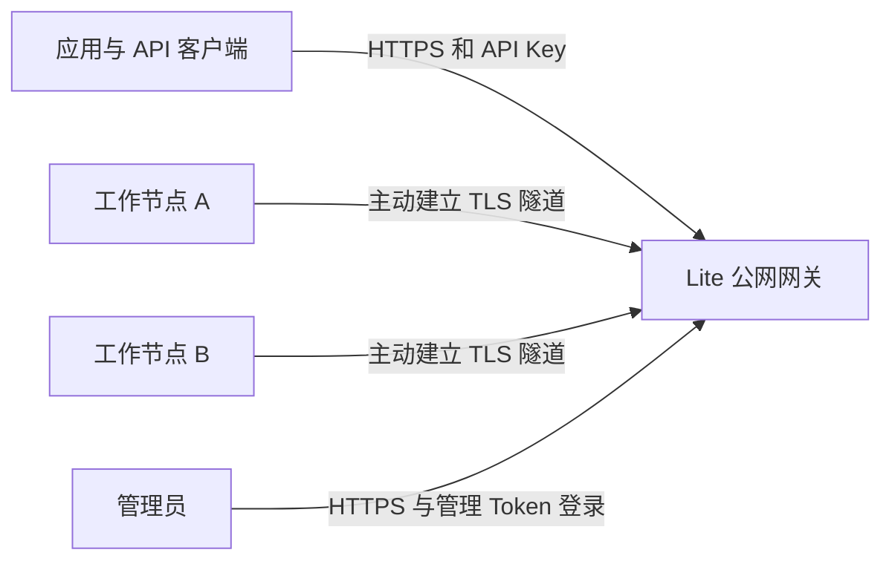

# 公网算力集群

公网模式让一台 Lite 网关对外提供统一推理 API，分布在不同网络中的 Lite 工作节点
主动建立加密连接，接收任务并在本机执行模型。工作节点不需要公网 IP、端口映射
或集群入站端口；网关可以不安装模型和推理引擎。

本模式独立于 CSGHub。现有局域网集群和接入 CSGHub 的边缘算力模式继续保留。

## 连接方式



隧道建立后双向传输：网关下发请求，工作节点返回普通响应或流式内容。网关不会
尝试回连工作节点的公网或私网 IP，工作节点也无需相互连通。

实现复用了已有集群的创建、加入令牌、节点 UUID、证书身份、成员表、移除、模型
目录和调度器。公网增加传输适配，没有独立的注册数据库或强制人工审批流程。

## 首期能力

| 能力 | 行为 |
|---|---|
| 独立公网网关 | 同一 Lite 二进制，单独配置 gateway 角色和公网监听器 |
| 出站工作节点 | worker 角色不启动 mDNS、集群直连监听器或成员 gossip |
| 令牌加入 | 沿用现有 cluster create 和 join，经验证的 HTTPS 完成首次配对 |
| 已加入节点重连 | 用原有节点私钥签署新的连接证明，无需重新注册或消耗配额 |
| 模型共享 | 默认不共享；由工作节点所有者明确选择本地模型 |
| 调度 | 复用现有模型、加载状态、负载、实测速度、会话亲和和节点隔离 |
| 流式推理 | 隧道多路复用，逐段返回内容，取消请求会传播到执行节点 |
| 节点管理 | 保留现有 CLI、私有管理 API 和集群页面；公网可用管理 Token 登录 |
| 权限隔离 | 推理 API Key、节点加入令牌与管理 Token 分离；公网管理必须先登录 |

第一期为单网关星形结构。一个实例选择 LAN、gateway 或 worker 角色，不同时
运行 LAN 与公网两套成员网络。多网关高可用、跨机器模型切分、音频和图像请求、
公网模型文件分发不属于本版本。

## 部署网关

先准备 HTTPS 域名证书，或带有目标 IP SAN、且工作节点信任的私有证书。

```sh
csghub-lite cluster configure-public \
  --role gateway \
  --listen 0.0.0.0:8080 \
  --cert-file /path/to/server-cert.pem \
  --key-file /path/to/server-key.pem
csghub-lite start
csghub-lite cluster create --name team
```

配置命令把设置写入现有 `config.json.cluster`。正在运行的实例使用
`csghub-lite restart` 应用角色配置；已有集群需先退出再切换拓扑或网关身份。
命令会把默认的管理监听地址设为 `127.0.0.1:11435`，自定义管理地址也必须为回环地址。

在登录后的公网控制台或网关的私有管理页面创建推理 API Key。公网推理始终校验 API Key，即使一般
远程 API 鉴权开关关闭、或流量由本机反向代理转入，也不会免鉴权。

若 TLS 在前置反向代理终止，可省略证书参数，把公网业务监听器绑定回环地址，
默认 `127.0.0.1:11439`。代理需支持 WebSocket 和 SSE，不得缓冲流式响应。
未配置 TLS 的公网业务监听器不能绑定主机对外接口。

## 接入工作节点

工作节点提前准备模型和推理引擎，再配置网关地址。

```sh
csghub-lite cluster configure-public \
  --role worker \
  --gateway https://gateway.example.com:8080
csghub-lite start
csghub-lite cluster join --token-stdin \
  --address https://gateway.example.com:8080 < /path/to/protected-join-token
csghub-lite cluster share Qwen2-0.5B-Instruct-GGUF
```

网关使用私有 CA 时，为配置命令增加 `--ca-file /path/to/gateway-ca.pem`。
证书必须匹配目标域名或 IP；不支持关闭证书校验。加入地址必须与配置的网关 URL
一致，不能通过一次请求偷偷改写连接目标。

共享参数使用本机准确的推理模型 ID，可在本机集群状态或模型列表中查看。
也可在工作节点集群页面的设置中编辑共享模型，每行一个 ID，保存后生效。

```sh
csghub-lite cluster unshare Qwen2-0.5B-Instruct-GGUF
csghub-lite cluster drain
csghub-lite cluster activate
csghub-lite cluster leave
```

停止共享和 drain 在工作节点入口再次检查，网关即使暂时持有旧目录，也不能继续
发起未经允许的新推理。已开始的请求允许完成。退出会清除本机共享列表；普通
进程重启保留身份、加入关系和共享选择。

## 调用接口

使用推理 API Key 的客户端仅可调用以下路径。登录后的管理员另外具有管理界面的权限。

| 方法 | 路径 | 用途 |
|---|---|---|
| GET | `/v1/models` | 当前能够调度的模型列表 |
| POST | `/v1/chat/completions` | OpenAI 兼容对话及流式输出 |
| POST | `/v1/embeddings` | 已支持模型的嵌入推理 |
| POST | `/v1/responses` | 现有无持久会话的 Responses 用法 |
| POST | `/v1/messages` | Anthropic 兼容消息 |
| POST | `/v1/messages/count_tokens` | 对应模型的 token 计数 |
| POST | `/api/chat`、`/api/generate` | Ollama 兼容接口 |

客户端使用自己的 API Key；代码示例、日志和共享文档中不得放入真实 Key。
Responses 的后台任务和 `previous_response_id` 延续不支持。具体模型是否支持
某种模态，仍由工作节点现有的推理引擎和模型能力决定。

公网入口省略 `source` 时进入集群调度；`source=cluster` 选择可用节点，
`source=node:<uuid>` 固定节点。`source=local` 及固定到网关本机的请求，只有
网关管理员明确打开本机接单时才可用。`cloud`、`provider:*` 和 `pool:*` 不在
该公网入口的路由范围内，拒绝时不会回落为本地执行。

网关到工作节点的每个请求固定本机执行。两端都验证方法和路径白名单，工作节点
还验证模型共享与接单状态。调用方的 API Key、Cookie 和节点连接证明不会传入
模型处理器。沿用现有按 API Key 隔离的会话亲和及请求追踪。

## 身份与授权

首次加入复用原有令牌 HMAC 握手，保存 UUID 和证书指纹。网关不把加入握手的
内部 HMAC 密钥分发给公网工作节点。后续连接使用原有节点私钥签署的时间戳、
随机数、节点、集群和网关身份，网关校验签名并拒绝重复连接证明。

从网关执行现有的移除命令，会保存成员移除结果、关闭对应隧道，并轮换加入
令牌，使旧邀请不能重新接纳被移除节点。其他已加入节点凭各自证书继续连接，
不受加入令牌轮换影响。重新接纳需要管理员提供当前有效令牌并重新加入。

沿用 `quota.lite.max_cluster_nodes`，包含网关本身：社区版可运行一个网关加
一个工作节点，企业版按授权扩容。扩容时检查网关、新节点和在线既有节点的许可
上限；已有节点需在线以便核验。超额或许可暂不可用时停止不合规调度，管理和
移除操作仍可用。License 设备激活数与集群成员配额分开计算。

## 运维与故障语义

- 应用层心跳默认每 5 秒一次，15 秒无有效状态后不再把隧道作为可用执行路径。
  UI 按健康轮询刷新，不把 TCP keepalive 当作模型可用证明。
- 断线按递增退避和随机抖动重连。有效成员在网络及网关恢复后自行恢复，撤销的
  身份停止自动重试，不自动重新注册。
- 网关重启后从磁盘恢复身份和成员；在线状态重新同步后才参与调度。
- 每个公网推理请求体最多 32 MiB，控制消息最多 1 MiB；公网最多同时接纳 32 条
  请求，达到容量返回 429，不建立无界等待队列。请求默认总时限为 10 分钟。
- 不能把“未收到响应头”等同于“没有执行”。执行状态不明的传输失败不自动
  重放；响应已开始后发生断流，不拼接其他节点的结果。
- 当前网关是服务入口单点；网关不可用时工作节点的本机服务仍可用。

## 管理界面与 Token 登录

在公网主节点执行：

```sh
csghub-lite cluster login-token
```

命令生成 256 位随机管理 Token，并仅在终端输出一次。打开网关的 HTTPS 地址
（例如 `https://gateway.example.com:8080`），会跳转到登录页；粘贴 Token 后进入
现有管理界面。没有 Token 时联系主节点管理员生成，不提供公网自助注册。

三类凭证用途独立：管理 Token 用于登录控制台；集群加入 Token 用于接入工作节点；
推理 API Key 用于应用调用。推理 API Key 不能进入管理界面或换取管理会话。

登录后使用 8 小时有效的 Secure、HttpOnly、SameSite=Strict 会话 Cookie，原始
管理 Token 不保存在浏览器存储。写操作还校验同源和 CSRF Token；退出登录立即
撤销该会话。服务器重启需要重新登录。再次运行 `cluster login-token` 会立即撤销
旧管理 Token 及所有旧会话，无需重启服务器。

磁盘仅保存管理 Token 的 SHA-256 摘要，文件为存储目录下的
`cluster/public_admin.json`，权限为 0600。它属于管理身份，现有推理 API Key 和
集群加入凭证不能表达该权限，因此单独存储；不在 `config.json` 增加重复配置。
未初始化或无法读取该凭证时，公网管理拒绝登录，推理与节点连接继续正常运行。

回环管理接口仍位于 `127.0.0.1:11435`，可通过 SSH 转发运维；公网完整管理接口
始终经过登录和 CSRF 校验。请使用可信 HTTPS 证书，私有证书需先导入信任。

## 账号与控制台关系（基于 PR #249）

当前工作区已实现统一的“访问与连接”面板，合入 main 的 `3d9a51b`（PR #249），
复用社区选择、账号详情、余额、充值及共享状态。面板从 `/auth/session` 获取
访问方式、实例名称和 Token 会话到期时间。设置保持独立入口。

### 控制台登录策略

默认 `auto` 模式下，主管理监听器对直接连接的回环、RFC1918 私网、IPv6 ULA 与链路本地来源免管理
Token 登录，访问地址也必须是本机或私网 IP、localhost 或本机名称。公网来源
必须使用管理 Token。含转发头的请求不享受免登录；专用公网监听器的明文代理
流量也不享受免登录，防止反向代理把公网访问变成本机访问。公网登录要求 HTTPS。
本机或局域网浏览器请求仍校验同源，拒绝跨站管理操作。

控制台免登录不等于免推理鉴权。同源控制台可以直接使用推理功能；普通程序的
局域网调用仍遵守 API Key 开关，专用公网推理监听器始终要求 Key。本机或控制台
请求携带有效 Key 时，仍按该 Key 记录用量。桌面模式继续自动建立 sidecar 会话，
会话异常只提示重连或重启，不跳转公网登录页；前端访问模式是运行时状态，
由服务端登录策略决定权限。公网模型上传的文件分片与其他写请求一样携带 CSRF 头。

需要本机或局域网也登录时，设置服务端变量并重启：

```sh
csghub-lite config set console_auth_mode required
csghub-lite cluster login-token
csghub-lite restart
```

也可以在启动服务的环境中设置 `CSGHUB_LITE_CONSOLE_AUTH_MODE=required`。
环境变量优先于配置文件，仅影响该进程，不写回配置；systemd/launchd 等服务需在
各自的服务环境中设置。配置或环境变量改变后需重启。

| 值 | 控制台页面及管理 API |
| --- | --- |
| `auto`（默认） | 直接本机、局域网访问免登录；公网及代理访问需要登录 |
| `required` | 本机、局域网、公网都必须先用管理 Token 登录 |

没有关闭公网鉴权的模式；无效配置会阻止服务启动。登录使用 HTTPS 安全 Cookie，
局域网/本机启用 `required` 后也需使用 HTTPS（可通过 TLS 反向代理并保留 Host），
不能直接在普通 HTTP 页面完成登录。生成 Token 前管理访问保持拒绝。
该开关同时覆盖普通控制台和专用公网控制台，不影响桌面 sidecar 自动鉴权，
也不改变推理 API Key 的独立策略。恢复默认使用
`csghub-lite config unset console_auth_mode` 并重启；若设置过环境变量，须同时移除。

配置唯一持久化位置为 `config.json` 的 `console.auth_mode`。新增 `ConsoleConfig`
是因为现有云端 `token`、集群成员配置及推理 `auth_enabled` 分别属于其他权限域，
不能表示控制台登录策略。旧配置缺少该字段时按 `auto` 处理。

手动云端 API Key 统一在“访问与连接”的云平台区域管理，可新增、替换或清除。
仅配置 Key 的实例也显示已有云连接；切换平台前需先断开连接，避免静默清除 Key。

CLI `cluster login-token` 可在需要远程管理的 Lite 实例生成凭据，不再限定为
集群网关角色。网络免登录显示“本机访问”或“局域网访问”，不显示退出按钮；
Token 会话显示“管理员 · Token 访问”及“退出控制台”。

### 两类身份的归属

| 对象 | 身份含义 | 作用范围 | 应展示的信息 |
|---|---|---|---|
| 控制台访问 | 当前浏览器有权管理这个 Lite 实例 | 当前浏览器会话 | 实例名称、管理员权限、Token 访问或本机访问 |
| CSGHub 连接 | 这个 Lite 实例使用哪个平台账号访问云服务 | 整个 Lite 实例，所有管理会话共用 | 平台名称与地址、账号头像、显示名、用户名、连接状态 |
| 推理 API Key | 应用调用推理服务的权限 | 对应调用方 | 保留在网关的调用密钥管理中 |
| 集群加入令牌 | 工作节点加入集群的资格 | 对应集群 | 保留在集群管理中 |

管理 Token 不包含个人用户名、邮箱或头像。界面显示“管理员 · Token 访问”，
不能把 CSGHub 的 James 头像拿来代表当前浏览器的操作者，也不能凭共享 Token
声称能区分或审计具体个人。多人独立身份、角色授权与按人审计属于后续能力。

当前 `config.json` 的社区地址、Token 和手动 API Key 是实例配置；PR #249 的
账号状态是它们的前端缓存。继续保留这一份来源，不另建一份“当前用户 CSGHub
账号”。网关的 CSGHub 连接也不会自动代表或下发给各工作节点。

### 固定入口与展示位置

保留侧栏底部入口的方向，改为固定的“访问与连接”。设置保持独立、始终可见，
不随是否连接 CSGHub 而藏进某个云账号菜单。

```text
侧栏底部
  设置
  访问与连接 ▾

展开面板
  当前控制台
    实例：生产推理网关
    管理员 · Token 访问
    会话有效期：至 18:30
    [退出控制台]

  CSGHub 连接                     已连接
    平台：OpenCSG · 平台域名
    [账号头像] James  @james
    此连接供整个 Lite 实例使用
    [账号详情与余额] [管理连接]
```

只有 CSGHub 区域使用真实账号头像、用户名、邮箱和余额。Token 区域使用控制台
或权限图标，不制造第二个用户头像。余额和充值继续复用 PR #249 的账号详情弹窗，
并明确显示所属平台及账号。余额查询失败显示“余额暂不可用”，不显示为零，也不
自动断开平台连接。

本机模式显示“本机访问”，无需添加新的本地账号登录；公网模式显示“管理员 ·
Token 访问”。未连接 CSGHub 时，同一面板的云服务区域显示“未连接”和“连接
CSGHub”。不因用户进入控制台就要求连接云平台。

### 命名与操作结果

| 当前文案或动作 | 设计文案或行为 |
|---|---|
| 公网“登录 CSGLite” | “访问控制台”，输入管理 Token |
| 公网“退出登录” | “退出控制台”，只撤销当前浏览器会话 |
| 社区“登录” | “连接 CSGHub”，选择平台并完成授权 |
| 社区“退出登录” | “断开 CSGHub”，确认影响整个实例后清除平台凭据 |
| 社区凭据过期 | 云服务区域显示“连接已过期”，提供“重新连接” |
| 切换社区或账号 | 在“管理连接”中进行，说明会影响本实例其他管理会话及依赖的云功能 |
| CLI 重新生成管理 Token | 撤销旧管理 Token 及所有旧控制台会话；保留 CSGHub 连接 |

断开平台连接后，依赖平台凭据的新调用需要重新授权；本地与独立集群推理仍按各自
权限和配置运行。已导入 License 按其自身有效期及许可规则校验，不能把“断开
CSGHub”描述为“注销 Lite”或“取消企业授权”。

### 状态与权限边界

| 控制台状态 | CSGHub 状态 | 展示与行为 |
|---|---|---|
| 未获访问权限 | 任意 | 显示控制台访问页，不展示实例绑定的云账号、余额和平台配置 |
| 已获访问权限 | 未连接 | 可以管理本机或集群；按需连接云平台 |
| 已获访问权限 | 已连接 | 分区展示访问身份和云账号；按云账号查看余额与使用云服务 |
| 已获访问权限 | 已过期或查询失败 | 保持控制台访问，仅提示对应的云连接问题 |
| 已退出或管理 Token 被轮换 | 已连接 | 浏览器回到访问页，实例的云连接继续保留 |

合并兼容修复：收到业务接口的 401 后，先查询控制台 `/auth/session`；只有该
会话接口也返回 401 才跳转访问页。云服务 401、网络故障和余额查询失败不能触发
控制台退出。此隔离与身份面板已在本工作区实现。

### 授权流程与后续能力

1. 已调整固定入口、两类身份的展示、文案和断开连接确认；复用 #249 的账号状态、
   社区记忆、详情及余额组件，不引入新的个人用户数据库。
2. 已通过现有 `/auth/session` 增加可选的会话类型、权限及到期时间，由后端提供
   当前访问身份；不把“浏览器存在 CSRF Cookie”作为身份事实。新增字段同步
   OpenAPI 并保留旧响应兼容性。
3. 本机访问保留现有浏览器授权；局域网及 Token 访问改用所选平台的访问令牌，
   经现有受保护的凭据保存接口建立连接。令牌只在输入过程中保存在内存，提交或
   关闭弹窗后清空，不放入浏览器存储。公网浏览器自动授权回调仍是后续能力。目前社区登录依赖 `state=lite` 的本机回调
   约定，不能直接认定从远程浏览器授权会写入公网网关。需核实平台支持的回调或
   设备授权协议；公网授权必须关联已验证的管理会话、一次性状态和目标平台，
   不能为接收 Token 而匿名开放现有写凭据回调，也不能弱化全局 Cookie 安全策略。
   完成此适配之前，不把公网浏览器自动连接平台视为已支持的能力。
4. 后续如引入 CSGHub 单点登录控制台，需增加独立的用户或组织准入授权。平台
   登录成功只证明身份，不自动赋予实例管理员权限；控制台身份与实例的云服务
   连接账号仍分别保存和展示，Token 保留为初始化及应急访问手段。

验收需覆盖：两类身份同时存在、仅 Token、本机访问、云连接失效、余额失败、
平台切换、两个浏览器共享实例连接、退出控制台、断开平台及管理 Token 轮换。
所有场景均须明确验证另一类身份是否被误清除，并检查未获控制台权限时不会泄露
账号信息。公网授权回调另外验证一次性状态、过期与重放拒绝。

## 实现与验证

- 角色配置：`internal/config/config.go` 的现有 `ClusterConfig`。
- 集群接入与生命周期：`ee/cluster/public_network.go`，复用现有成员 Store。
- 出站隧道：`ee/cluster/public/`；`ee/tunnel` 与现有 CSGHub edge 共用字节传输基础。
- 公网推理及鉴权：`internal/server/cluster_public.go`。
- 管理：现有集群 CLI、API 和页面，新增角色配置、共享模型、公网状态展示与 `cluster login-token`。
- API 契约：`openapi/local-api.json`，同时包含专用监听器的 `/cluster/v1/*` 协议入口。

测试覆盖 TLS、流式输出、取消传播、共享撤销、心跳失联、会话替换、加入配额、
身份重放、进程重启和成员撤销，并检查现有 LAN 与 CSGHub edge 回归。
公网实机验证使用两台独立机器及 Qwen2 0.5B GGUF 模型，验证了普通推理、流式
输出、外网客户端访问、第三节点配额拒绝和工作节点重启恢复。实际时延依设备和
网络而变化，不据此承诺规模化吞吐或高可用指标。
